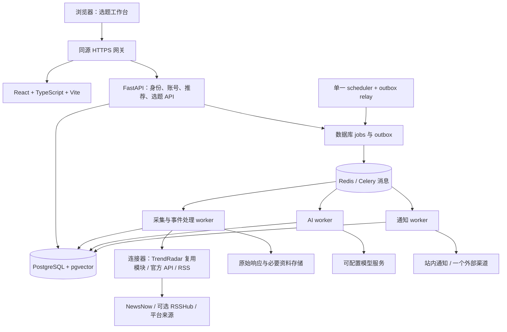

> 历史设计与实施记录（2026-10）；不构成本次发布的验收结论，未实现部分仍是方案。

# 多赛道热点选题工作台：实现架构

版本：独立服务设计稿 v1.0。日期：2026-10-17。后续已根据现有平台改为 Flask + SQLite 桌面内集成；实际实施内容见 [集成说明](integration.md)。下文为未来独立服务扩展方案，不代表已实现能力或当前安装要求。

## 1. 推荐实施路线

以 **TrendRadar 为主 fork**，复用其 Python 采集、RSS、AI 调用和通知适配能力，增加多用户、多创作账号、事件层、可解释推荐和选题工作台。保留上游 GPL-3.0 许可证及修改记录。NewsNow 可自托管为热榜入口，RSSHub 按需补充垂直内容；这些服务通过标准连接器接入。

这条路线优先复用已存在的数据处理能力，同时对新增业务采用统一的 PostgreSQL 数据模型。开源代码的实际可运行性、接口有效性和改造边界，需要在第一阶段做小范围验证。

主 fork 和备选路线的事实依据、源码入口与许可证见[核心开源项目审查](open-source-core-review.md)。扩展数据源见[补充数据源项目](source-projects.md)。

## 2. 产品边界与容量假设

首版服务于个人和小团队：1—10 名用户，最多约 20 个活跃创作账号，先接 3—5 个互补来源，验证后扩至 5—8 个。上述数字用于设计和压测，不是已验证的容量承诺。

首版完成：

- 账号配置：内容领域、表达方式、受众、地区、制作形式和周期。
- 模板：泛知识科普、人物故事、餐饮经营、本地美食，以及自定义模板。
- 发现：上升热点、长期选题、我的关注；按账号独立排序。
- 事件详情：证据来源、时间线、趋势、不同切入角度和资料缺口。
- 创作：收藏、选题状态、带依据的提纲、反馈、Markdown 导出。
- 运行：数据源健康、任务重试、AI 预算、一个外部通知渠道、备份。

后续再增加：私有订阅源、平台作品表现回流、更复杂的团队协作、多通知渠道、向量索引扩容。首版不承诺全平台覆盖、全网评论情感统计、自动发布和精确爆款预测。

历史曲线从真实采集起逐步积累；“保留 30 天”是保留策略，不表示新部署就拥有 30 天历史。

## 3. 核心领域模型

产品中的“赛道”在数据层拆成 **领域 × 表达方式 × 目标受众**。

| 对象 | 含义 | 例子 |
|---|---|---|
| 工作空间 workspace | 权限、预算和私人资料的边界 | 你自己的空间、朋友的空间 |
| 创作账号 creator_account | 独立的内容定位与制作工作流 | 科普号、故事号、餐饮号 |
| 领域 domains | 内容讨论什么，可多选 | 食物、餐饮经营、科技、历史 |
| 表达方式 expression_modes | 如何组织内容，可多选 | 原理科普、人物故事、经营分析 |
| 受众 audiences | 给谁看 | 普通大众、餐饮老板、本地消费者 |
| 赛道模板 track_template | 可复制的完整默认配置 | 面向餐饮老板的经营分析 |
| 账号配置版本 profile_version | 某时刻实际生效的定位 | 第 3 版：增加本地店主故事 |
| 事件 event | 来源共同描述的一件事 | 某家老店重新开业 |
| 推荐 recommendation | 某账号在某时刻对事件的评估 | 科普角度与故事角度分别排序 |
| 选题 topic_card | 用户已选中的创作任务 | 已确定角度、正在制作的提纲 |

模板升级不会静默改变已有账号。创建、复制或修改定位时，保存完整配置快照，生成新版本并重算该账号的候选推荐。已有选题稿保持原版本，收到新材料提示后可主动更新。

同一事件在某账号的推荐列表默认只出现一次，内部可有多个角度；用户可以从同一事件创建多个不同角度的作品。

## 4. 总体拓扑与技术选择



这是一个后端代码库、多个运行进程的模块化应用。各模块通过明确的服务接口协作，数据库是业务事实的唯一权威存储。

| 层 | 建议选择 | 原因与边界 |
|---|---|---|
| 前端 | React、TypeScript、Vite；查询缓存与图表组件 | 适合交互工作台，接口类型从 OpenAPI 生成 |
| API | FastAPI、Pydantic | 与 TrendRadar 的 Python 模块衔接；统一配置和输出校验 |
| 数据访问 | SQLAlchemy、Alembic | 显式事务、版本迁移和复合外键 |
| 业务数据 | PostgreSQL | 账号、事件、历史、证据、任务和预算统一保存 |
| 语义检索 | pgvector | 先对受范围限制的小候选集精确搜索，再按压测决定近似索引 |
| 中文检索 | 应用侧分词 + PostgreSQL 全文索引 | 中文标题和正文先分词，查询端使用相同词典版本 |
| 执行队列 | Celery + Redis | 分开运行采集、AI 和通知任务；数据库记录实际状态 |
| 调度 | 一个独立 scheduler | 只依据数据库计划创建任务；不并行启用 Celery beat 和旧 cron |
| 文件 | 首版受控本地数据卷，Storage 接口可切 S3 兼容存储 | 保存必要原始响应、证据片段和导出件；另地备份 |
| 部署 | Linux + Docker Compose | Windows 用于开发，生产监控持续运行 |

具体依赖版本在实现阶段依据上游锁文件、运行兼容性和安全更新统一固定，不使用浮动 latest 标签。

pgvector 提供精确与近似向量检索；带条件过滤的近似检索需要额外验证召回数量，首版的小规模检索优先选择范围过滤后精确计算。[pgvector 官方说明](https://github.com/pgvector/pgvector)

中文分词可先采用 jieba 的搜索模式和自定义领域词典，再交给数据库索引；它是待验证的实现选择，不表示所有中文长文本检索效果已经达标。[jieba 官方说明](https://github.com/fxsjy/jieba)

## 5. 复用开源模块的具体边界

TrendRadar 已有 AppContext(config)，因此改造应沿用显式上下文。需要重点处理的是当前存储管理器的进程级单例，以及原有按日 SQLite 存储与新业务数据库的关系；不能把“多个关键词分组”当作已经具备多个独立创作账号。

| 上游能力 | 拟采用的方式 | 新增部分 |
|---|---|---|
| 热榜与 RSS 抓取 | adapter 包装现有抓取结果，转换成统一 DTO | 原始平台标识、scope、完整性和时间语义 |
| 原有 SQLite 历史 | 用于基线回归和按需历史导入 | PostgreSQL 跨日事件、版本、账号与趋势模型 |
| AI 客户端 | 包装 provider 调用与响应 | 结构化事实、引用校验、账号角度、预算、版本缓存 |
| 关键词筛选 | 用于召回与显式排除 | 受众、表达方式、证据和制作周期匹配 |
| 通知渠道适配 | 包装具体发送函数 | 通知账本、规则、冷却、权限与回执 |
| HTML 报告 | 开发诊断或兼容导出 | 新 React 工作台与有状态选题管理 |
| 原有定时入口 | 新流程中停用 | 统一 scheduler 和任务账本 |

具体抓取函数能否直接返回足够完整的 DTO，应通过原型验证；如果需要临时读取 SQLite，只允许使用带检查点的只读导入器，并为来源身份、日期和原始记录键建立映射。新业务数据以 PostgreSQL 为准，禁止两个存储对账号和选题互相覆盖。

新队列启用通知后，关闭上游旧通知入口，避免一条事件由两个流程重复发送。对上游存储单例采用显式实例注入或独立进程隔离，不能在并发请求中反复重设全局对象。

## 6. 后端模块划分

| 模块 | 输入 | 输出及职责 |
|---|---|---|
| identity | 登录会话、空间成员关系 | 服务端授权上下文 |
| accounts | 模板、用户定位 | 不可变账号配置版本 |
| sources | 来源配置与能力 | 可调度连接器、健康状态 |
| ingestion | API/RSS/页面返回 | 文档版本、来源快照、观测 |
| events | 标准文档与候选事件 | 稿件关系、事件关联和新版本 |
| trends | 有效历史观测 | 特征快照、缺失原因、覆盖度 |
| recommendations | 账号版本、事件与特征 | 排序、理由、角度候选 |
| evidence | 正文版本与提取结果 | 有出处的事实、冲突与缺口 |
| generation | 账号版本与证据包 | 科普或故事提纲、引用与状态 |
| topics | 用户选择及编辑 | 选题状态、稿件版本、反馈 |
| notifications | 推荐变化、规则 | 站内记录、外部发送账本 |
| platform | jobs、outbox、预算、审计 | 执行、追踪、恢复与运维 |

模块不直接调用彼此的 HTTP 接口；同一代码库内使用服务函数，长耗时步骤写入数据库任务。来源与模型接口通过适配层隔离，方便替换。

## 7. 数据采集与标准化合同

每个连接器至少实现 `fetch(binding, cursor) -> FetchBatch`，可提供 `validate_config` 与 `health_probe`。FetchBatch 是版本化 DTO，字段包括：

```text
connector_version, source_binding_id, upstream_platform, board_key
fetch_run_id, observed_at, source_updated_at?, next_cursor?
is_complete, response_hash, upstream_cache_age?, raw_object_ref?
items[]:
  native_item_id?, canonical_url, title, summary?, body?
  published_at?, original_time_text?, time_confidence
  rank?, board_size?, metric_values{}, metric_units{}
  content_access: title_only | excerpt | full_text
```

具体规则：

1. 同一平台经不同聚合服务取得的内容，保留原始平台身份和聚合入口，趋势去重按真实平台进行。
2. 文档身份优先使用来源原始 ID；URL 规范化由来源规则决定，不随意删除可能决定文章身份的参数。
3. 正文、标题有实质变化时新增文档版本。指标变化独立保存，不能因正文哈希相同而跳过热度处理。
4. 每次请求有 fetch_run；有效来源快照可以复用同一版本。重复返回的上游缓存不算多份独立增长证据。
5. 若来源没有更新时间，记录观测时间和“源发布时间未知”；趋势只能称作观测变化。
6. 来源失败或不完整榜单不产生“下榜”事件。完整且成功的榜单中未出现，最多说明跌出榜单覆盖范围。
7. 接入页面正文受内容可用范围和配置约束。仅有标题时进入发现池，不生成细节齐全的事实稿。

所有持久化时间使用 UTC 的 timestamptz。发布时间、首次发现时间、源更新时间、事件发生时间与处理时间分别存储；来源时区不明时保留原始文本和解析状态。

## 8. 事件聚合与修订

流程：标准化文档 → 识别同稿转载 → 提取实体/动作/地点/时间 → 召回候选 → 判断关系 → 更新事件版本。

候选召回先按时间与范围限制，再结合中文关键词、实体和向量相似度。第一版候选上限建议 20 个，具体阈值通过标注集调整。

关系判定输出 `same_event / update_of / related_to / different_event / uncertain`。同名人物、跨年重复事故、不同门店等情况先检查冲突；不确定时保留独立记录，允许后台人工修正。

转载关系形成 report_family。传播范围可以增加，但独立证据数量不按转载站点数量增加。热榜词本身和文章分别标注内容类型，防止把话题词当作完整报道。

事件有稳定 event_id 和递增的内容版本。合并保留旧 ID 重定向；拆分保留父子关系和成员修订历史。旧推荐、旧提纲与已发通知仍引用旧版本，新的更正通过显式状态提示。

趋势更新只生成新的 feature_version；事件内容没有变化时不重复调用 AI。新增关键证据或时间线进展才更新 evidence_set_hash，触发摘要和相关账号角度的失效重算。

## 9. 趋势与多账号推荐

趋势分别计算平台内热度、增长、传播、持续时间和数据覆盖。计数指标按真实时间间隔计算增量；排名采用榜单排名变化，不能直接计算成阅读量增长。

有充分历史样本时，使用同平台、同榜单、同指标的历史分布做归一化。冷启动时可显示原始排名、排名变化和观测间隔；缺少基线就不显示伪精确的历史百分位。

多个来源的热度不直接相加。先构造各平台特征，再汇总为事件特征；每个平台贡献设置上限，源故障期间标记缺失。旧文章今天首次发现，不自动算成新事件；历史补录不触发当前突发通知。

推荐分五步：

1. 在用户有权访问的事件池召回候选；热榜与资料型来源均可进入。
2. 应用硬条件：禁选主题、严格地区、语言、内容访问范围及用户隐藏项。
3. 计算账号相关性、趋势、创作价值、证据充分度、制作可行性和账号内新颖性。
4. 按账号策略排序，并做同事件去重与少量探索。
5. 保存输入版本、分项得分、缺失指标和可以核对的推荐理由。

初始化权重只是可调默认值：

| 模板 | 相关性 | 上升趋势 | 创作价值 | 证据 | 可制作性 | 账号内新颖性 |
|---|---:|---:|---:|---:|---:|---:|
| 泛知识科普 | 0.30 | 0.15 | 0.20 | 0.20 | 0.10 | 0.05 |
| 人物故事 | 0.25 | 0.05 | 0.30 | 0.25 | 0.10 | 0.05 |
| 餐饮经营 | 0.30 | 0.10 | 0.25 | 0.20 | 0.10 | 0.05 |

各分项归一为 0—1。存在指标的加权平均映射到 0—100，另存 coverage 和 uncertainty；缺失指标不当作零。只有有效趋势样本才能进入“上升热点”，缺少趋势但资料充分的题材可以进入“长期选题”。证据不足限制生成状态，不能靠高热度抵消。

创作价值按表达方式计算：科普看问题可解释性、受众价值和事实支撑；故事看可核实的人物目标、困难、行动、转折与结果；餐饮经营看案例与经营者需求的联系。系统不凭未获取的数据声称“全网竞争低”或“你的粉丝最喜欢”。

示例配置见 [account-profile.example.json](account-profile.example.json)。其中四川、餐饮老板、短视频均是演示值，不代表用户和朋友已选择这些定位。

## 10. AI 证据与创作提纲

AI 按三个阶段执行，每阶段都保存结构化结果：

1. **事实提取**：claim、来源文档版本、原文位置或短片段、事实时间、证据类型。
2. **账号角度**：核心问题、受众价值、适配形式、缺失资料、制作难度依据。
3. **创作提纲**：标题候选、开头问题或人物处境、段落结构、引用、建议画面与待核实项。

系统校验引用 ID 与访问范围、文档版本、引文匹配、关键数字、时间和输出结构。事实冲突明确保留。一次模型自评不能代替引用检查。

科普模板强调问题、原理、实例、适用范围；故事模板强调人物、处境、选择、行动、转折与结果。没有来源的对白、心理活动或情节不补写。建议采集的画面与已拥有的素材分开显示。

缓存键包含 `scope_id + account_profile_version + event_content_version + evidence_set_hash + prompt_version + model_config_version + output_schema_version`。公共事实摘要可在 public scope 内复用；私人定位、角度、笔记和生成内容只在所属 workspace 内缓存。

输出状态为 `queued / generating / needs_review / ready / failed / stale`。ready 表示结构和证据检查满足当前生成规则，不等同于系统保证全部报道事实真实。

模型只读取受控资料，不授予源文中的指令执行能力。网页、RSS、提示词注入内容都作为数据处理；模型不得自行发消息、改账号配置或调用任意 URL。

## 11. API 合同与交互一致性

统一前缀 `/api/v1`，使用 JSON、游标分页、ISO 8601 时间和明确的错误码。所有写操作记录 request_id；创建选题、生成提纲与测试通知接受 Idempotency-Key，作用域包含用户和 workspace。

| 方法与路径 | 用途 | 关键约束 |
|---|---|---|
| GET /me | 当前身份、空间与角色 | 只返回可访问空间 |
| GET /workspaces/{wid}/accounts | 创作账号列表 | 校验成员关系 |
| POST /workspaces/{wid}/accounts | 创建账号与第一版定位 | 配置服务端校验；名称可重复，ID 唯一 |
| POST /accounts/{aid}/profile-versions | 保存新的完整定位版本 | 传 expected_current_version，冲突返回 409 |
| GET /templates | 公共和本空间模板 | 返回模板版本和可用能力 |
| POST /templates/preview | 自然语言生成配置草案 | 202 + job_id；不会自动启用来源或通知 |
| GET /accounts/{aid}/recommendations | 账号推荐列表 | lane、cursor、run_id；返回配置与计算版本 |
| POST /accounts/{aid}/recommendation-runs | 申请重算推荐 | 202；合并重复请求并限频 |
| GET /events/{eid} | 时间线、资料和基础事实 | 不附带其他空间的私有补充 |
| GET /events/{eid}/trend | 趋势序列 | window、粒度、覆盖度、缺失原因 |
| POST /accounts/{aid}/topic-cards | 从事件或角度建立选题 | 同一事件允许不同角度；幂等键防重复点击 |
| PATCH /topic-cards/{tid} | 改状态、计划或笔记 | expected_version；权限与状态机校验 |
| POST /topic-cards/{tid}/outlines | 生成或更新提纲版本 | 202；先预留预算，结果不覆盖用户编辑稿 |
| POST /accounts/{aid}/feedback | 采用、隐藏、不合适及原因 | 限定本账号；保存对应推荐版本 |
| GET /jobs/{jid} | 异步状态 | 只返回授权范围内的安全结果和错误信息 |
| GET /workspaces/{wid}/sources | 来源、覆盖与健康 | 隐藏凭证；测试路由需要编辑权限 |
| POST /workspaces/{wid}/sources/{sid}/probe | 验证已配置来源 | 202；有限调用，不暴露任意代理能力 |
| GET /topic-cards/{tid}/export | 导出 Markdown | 检查当前权限，包含引用和内容版本 |
| GET /workspaces/{wid}/usage | 预算与实际使用 | 只返回本空间数据 |

长任务返回例子：

```json
{
  "job_id": "job_example",
  "status": "queued",
  "status_url": "/api/v1/jobs/job_example",
  "request_id": "req_example"
}
```

推荐列表使用固定 recommendation_run 的游标，避免用户翻页时榜单变化造成大量重复或漏项。新版本就绪后提示刷新；账号配置变更期间，旧列表标明使用旧定位，不冒充新定位已生效。

首版前台任务状态使用有限退避轮询；没有活跃任务时停止轮询。后续需要更及时反馈再增加 SSE，不把长连接作为可靠执行的前提。

## 12. 前端页面与状态

| 页面 | 核心内容 | 必须处理的状态 |
|---|---|---|
| 账号与定位 | 新建、复制模板、配置与试推荐 | 校验失败、配置版本冲突、暂无来源 |
| 选题雷达 | 上升热点、长期选题、我的关注 | 冷启动、重算中、部分源延迟、零结果 |
| 事件详情 | 时间线、原文、趋势、角度 | 标题级资料、冲突、事件合并/拆分、缺失数据 |
| 我的选题库 | 待观察、已选题、制作中、已发布、已放弃 | 编辑冲突、生成失败、新证据出现 |
| 资料与提纲 | 事实引用、提纲编辑、版本和导出 | 引用失效、预算不足、草稿需复核 |
| 来源设置 | 来源分类、范围、更新时间、健康 | 授权过期、解析变化、不可用路由 |
| 运行设置 | 通知、时区、预算、空间成员 | 通知未启用、额度耗尽、发送结果未知 |

首屏不要求等待全部 AI 分析：先显示有证据链接的事件、规则推荐和数据状态，摘要或角度异步补全。显示“为什么推荐”时使用已保存的规则证据，避免浏览时让模型临时编写理由。

图表的空白表示数据缺失；下榜、源故障和零增长使用不同状态。所有“首次发现”都明确是本系统观测，不展示为事件起源。

## 13. 权限、身份与数据边界

用户可以加入多个 workspace；每个账号属于一个 workspace。首版可只暴露 owner/member 两级，后台数据运营权限单独处理。来源凭证、个人笔记、账号偏好、生成稿和反馈属于空间。

数据资料使用非空 scope_id：一个明确的公共 scope，以及每个 workspace 对应的私有 scope。首版只接公共来源，但建表就保留范围字段。

公共事件只由公共资料计算摘要、计数、特征和向量。未来启用私有资料时，在私有 scope 建立补充事件或分析，通过显式关系引用公共事件；不改变公共事件的任何派生字段。

每次 API 请求先验证会话与成员关系，再创建服务端授权上下文。数据库常规连接角色不使用表所有者、超级用户或 BYPASSRLS；工作空间上下文通过事务内设置，事务结束即清除，避免连接池串用。RLS 作为纵深防护，应用层仍显式执行授权。[PostgreSQL 行级安全说明](https://www.postgresql.org/docs/current/ddl-rowsecurity.html)

检索、向量召回、缓存、生成、导出、后台任务和对象下载都使用同一范围约束。缓存键至少包含 scope/账号/输入版本。用户提交的 workspace_id 不作为已经授权的证据；任务的归属从受保护的 jobs 记录读取。

会话采用服务端管理和 HttpOnly、Secure、SameSite Cookie；变更接口做 CSRF 防护。登录可接成熟的 OIDC 身份提供方，首版邀请制；不把 NewsNow 的 GitHub 阅读同步直接视作本系统的完整权限模型。

允许用户配置的 URL 需要限制协议、目标网络和重定向，防止访问内部服务。系统自托管 NewsNow/RSSHub 使用显式配置的可信服务地址，与用户 URL 的抓取策略分开。页面内容与 Markdown 渲染清理可执行 HTML；凭证保存在服务端密钥引用中。

具体外键、索引、内容混合引用和 RLS 边界见[数据模型](data-model.md)。

## 14. 调度、重试与通知

一个 scheduler 根据 source_schedule、账号重算计划和通知计划生成任务。创建 jobs 与 outbox、推进计划在同一数据库事务完成。relay 投递 job_id 到 Celery，worker 通过数据库领取租约并读取授权输入。

外部抓取和模型请求在短数据库事务之外执行；保存结果、完成任务、创建下游任务在同一提交内完成。重复投递通过 dedupe_key、结果唯一键和租约令牌处理。

任务采用至少一次投递。worker 退出、Redis 重启或 outbox 发布中断时，scheduler 根据数据库任务账本补偿。运行超时后的旧 worker 必须无法覆盖新结果。

通知只对首次命中、跨越明确的升温阈值、实质新进展触发。按账号配置冷却、每日上限和本地时区免打扰。示例配置默认关闭外部通知，渠道由用户实际选择后启用。

外部发送超时可能已成功，标记 delivery_unknown 并核对回执；数据库唯一键不保证外部平台绝对只收到一次。通知触发使用语义变化版本，不以每一次排名变化制造新通知。

FastAPI 进程内后台任务适合小型附带工作，本系统的长期采集和 AI 分析独立运行。[FastAPI 后台任务说明](https://fastapi.tiangolo.com/tutorial/background-tasks/)

完整任务状态机、Celery 参数边界、恢复策略和发送账本见[运行与可靠性](operations.md)。

## 15. AI 成本、存储与降级

先做规则筛选、转载去重和事件复用，再调用模型。事件级公共事实只生成一次；账号角度优先处理每天排名靠前或用户点开的事件。正文长时按证据相关性选片段，并保留被省略范围。

对全站、workspace 和单任务设置预算；调用前原子预留，结束后按实际用量结算。预算不足时保留采集、趋势、搜索和规则推荐，暂停可延后的生成。模型请求超时可能产生费用，按待对账状态记录。

成本分项估算：计算与存储 + 数据源费用 + embedding + 摘要/角度/提纲 token + 通知。模型单价和来源费用在实际选定供应商后填写，不预设“每月固定几十元”等未经核算的结论。

建议首版保留 30 天原始趋势观测，之后可按小时压缩；被选题、审阅或导出引用的证据版本按单独规则保留，不能随普通观测清理而消失。内容删除或访问撤销时，关联缓存和分析作失效处理，已编辑稿提示引用不可用。

## 16. 建议代码目录

以下是主 fork 的目标目录，既有 TrendRadar 模块保持可追溯，新代码放到独立区域。实际文件布局可依上游固定版本微调。

```text
repository/
  trendradar/                    # 上游模块，改动保持小且有说明
  apps/
    web/                        # React 工作台
  creator_platform/
    api/                        # HTTP、身份与请求模型
    modules/
      accounts/ sources/ ingestion/ events/ trends/
      recommendations/ evidence/ generation/ topics/ notifications/
    adapters/
      trendradar/ newsnow/ rss/ models/ storage/
    platform/
      db/ jobs/ scheduling/ outbox/ budgets/ auth/ telemetry/
    workers/                    # Celery 入口与任务注册
    schemas/                    # 配置、连接器、模型输出 schema
  migrations/                   # PostgreSQL 迁移
  templates/                    # 预置赛道与提示词版本
  tests/
    fixtures/ contracts/ integration/ replay/ permissions/
  deploy/                       # Compose、环境样例、恢复脚本
  docs/                         # 本设计、ADR、数据源能力与变更记录
```

`adapters/trendradar` 是上游升级边界。业务模块只调用自己的接口，不把上游对象、全局状态或日数据库文件路径散布到控制器里。记录 upstream remote、固定提交、修改清单和第三方许可声明，升级后先跑连接器合同与历史回放。

## 17. 开发阶段与验收门槛

| 阶段 | 交付内容 | 结束条件 |
|---|---|---|
| P0：开源基线与来源验证 | 固定 TrendRadar/NewsNow 提交；运行原版；检查候选来源与模块返回结构 | 3—5 个互补源样本可用；许可证与依赖记录完整；明确保留和改造文件 |
| P1：采集与公共事件 | PostgreSQL、唯一调度、连接器、观测、文档版本、事件聚合、源健康 | 相同任务重复执行无重复结果；源失败不会生成假降温；可回放原始样本 |
| P2：可用选题产品 | 登录空间、账号模板与自定义配置、双列表、详情、选题库、反馈 | 新增餐饮/其他方向无需改代码；相同事件在不同账号呈现不同适配理由 |
| P3：证据与生成 | 事实引用、冲突、科普/故事提纲、预算、版本化导出 | 关键事实可定位原文；无资料不补故事；编辑稿不会被自动覆盖 |
| P4：封闭试用 | 一个外部通知渠道、故障恢复、备份、隔离验收、运营面板 | 朋友与用户各自空间隔离；任务恢复通过；发送未知有明确处理；备份成功恢复 |
| 后续迭代 | 私有源、发布结果回流、推荐调优与更多渠道 | 由真实使用反馈与可观测瓶颈决定 |

P0 即开始连续采集，完整 7 天稳定性观察可以与后续开发并行。完成任务后的验收以可用数据与行为为准，开发耗时应在 P0 后根据实际接口和代码质量估算。

## 18. 质量与性能验证

建立人工标注回放集，覆盖科普、故事、餐饮，每个方向建议先收集至少 50 个候选事件，另加入旧闻重热、同名主体、转载、跨平台同榜、源缓存、字段变化、断流和迟到数据。

回放只允许使用当时已观测到的信息，不能用后续报道帮助早期判断。分别报告误合并、漏合并、Top-10 适配率、重复率、人工采纳和拒绝原因。首轮样本用于确定可接受阈值，不预先宣称固定准确率。

必须通过的正确性检查：

- 相同批次重试不重复生成文档版本、事件成员或选题。
- 正文未变但真实热度改变时，趋势更新；重复缓存不虚增独立样本。
- 私有来源、向量、摘要、计数、缓存和导出不能泄漏到其他空间。
- 人物故事的关键事实和科普中的数字能回溯到具体文档版本。
- 账号定位变化产生新推荐版本，不修改已经编辑的选题稿。
- Redis、worker 或调度器重启后，可依据数据库恢复待办任务。
- 预算并发预留不超过上限；发送结果未知不由通用重试器盲目重发。
- 事件拆分合并、内容删除和来源撤稿后，历史引用显示修订状态。

性能目标在基准环境下验证：缓存后的推荐列表 API p95 小于 800 ms；一次已抓取批次在正常队列下 2 分钟内进入基础事件列表，AI 提纲单独计时。基准建议包含 20 个账号、5 万条文档、100 万条观测和 10 个并发浏览会话；这些都是测试目标，不是当前实测结果。

从来源真正发布到被发现的时间，包含上游更新、聚合缓存、轮询和处理排队，不能与纯后台处理时间混为一谈。

## 19. 当前仍需实施验证的事项

- 用户与朋友的发布平台、关注地区、具体受众和制作周期，可在账号设置中填写；无需阻塞通用架构。
- 3—5 个起步来源的真实接入、字段、网络位置、费用和更新时间。
- TrendRadar 固定版本的模块调用合同、存储单例处理和原有 AI 输出的转换成本。
- NewsNow 返回的缓存时间和条数范围，应由 connector 明确标注；不能当作全量平台数据。
- 模型提供方、embedding 维度、调用价格、输出可靠性和中文召回质量。
- 生产服务器、通知渠道与备份位置。部署和启用实际外发属于后续实施步骤。

完整字段模型见[数据模型](data-model.md)，运行参数与故障验收见[运行与可靠性](operations.md)。

