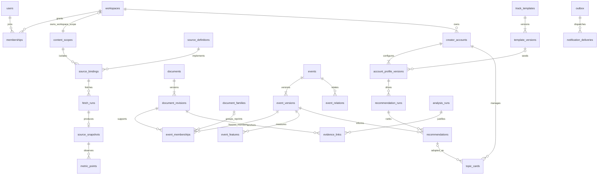

> 历史设计与实施记录（2026-10）；不构成本次发布的验收结论，未实现部分仍是方案。

# 热点选题工作台：数据模型与隔离设计

> 状态：实施设计，尚未建立数据库、编写迁移或实现接口。本文独立于任何开源项目选型，作为自建或二次开发时的数据契约。设计日期：2026-10-17。

## 1. 范围与取舍

产品服务多个创作者，每个人可以管理多个内容账号。底层采用“领域 × 表达方式 × 目标受众”的组合：餐饮属于领域，科普、人物故事属于表达方式；同一账号可以组合多个领域和表达方式。账号指创作定位，不等同于发布平台的登录账户。

MVP 接入平台统一维护的公共信息源，提供事件聚合、历史观察、账号推荐、选题库和一个通知渠道。各工作空间的账号配置、反馈、草稿和选题状态从第一版就隔离。用户自带凭证的来源、私人 RSS、内部资料等后续再开放，数据模型现在预留其边界。

下文列出约 30 个逻辑实体，分组说明，不要求一次性建立所有独立物理表。`event_features` 在 MVP 可放入不可变的 `event_versions.features`；`feedback` 可先作为审计日志中的结构化事件；模板目录与模板版本也可先合并为带系列键和版本号的一张表。不能省略范围隔离、来源观察、关键不可变版本和证据引用。

标记含义：**MVP** 为第一版需要的逻辑能力；**预留** 为设计好边界、后续启用；**可合并** 表示物理实现允许简化。

## 2. 基本约定

- 标识符采用 `uuid`。时间采用 `timestamptz`，服务端以 UTC 处理；展示和定时通知使用账号或用户明确配置的时区。
- 默认字段为非空；下文用 `?` 表示可为空。所有业务表含 `created_at timestamptz`；可变实体另含 `updated_at timestamptz`。
- 所有内容及其衍生结果都带非空 `scope_id uuid`，引用 `content_scopes`。身份、系统来源目录等控制面数据另行授权，不伪装成公共素材。
- `jsonb` 只用于经过 JSON Schema 校验的版本化配置、模型结构化输出和供应商原始字段。经常过滤、关联、排序和约束的字段保留为列。
- `numeric` 存平台原始指标，`double precision` 存可重算的派生分数。缺失值用 `NULL` 和缺失原因，不用 `0` 代替。
- 凭证保存为密钥存储中的引用 `secret_ref text?`。原始页面、响应和正文可存对象存储，用私有对象键引用，不在数据库保存长期公开下载地址。
- 下文 `U(...)` 表示唯一约束，`I(...)` 表示普通索引。除业务唯一键外，范围对象提供 `U(scope_id, id)`，供复合外键使用；不要为已有索引重复建同样的索引。

## 3. 身份、空间与范围

| 表 | 阶段 | 主要字段 | 约束与索引 |
|---|---|---|---|
| `users` | MVP | `id uuid`、`auth_provider text`、`auth_subject text`、`display_name text`、`timezone text`、`status text` | `U(auth_provider, auth_subject)`；身份系统负责认证，不自建明文密码字段 |
| `workspaces` | MVP | `id uuid`、`name text`、`owner_user_id uuid`、`status text`、`authorization_version bigint` | 所有权变更和成员变更递增授权版本；空间删除先进入禁用状态 |
| `memberships` | MVP | `workspace_id uuid`、`user_id uuid`、`role text`、`status text`、`joined_at timestamptz` | `U(workspace_id, user_id)`；`I(user_id, status)`；MVP 采用 owner/editor/viewer 三种角色 |
| `content_scopes` | MVP | `id uuid`、`scope_type text`、`workspace_id uuid?`、`status text` | `scope_type` 仅 public/workspace；public 时工作空间为空，workspace 时必须存在；公共范围全局唯一，每个工作空间最多一个范围 |

`workspaces.owner_user_id` 与 owner 成员关系由同一事务维护；不能留下无 owner 的活动空间。公共范围是平台内部共享素材池，并不意味着允许匿名用户或浏览器直接访问数据库。

工作空间是协作与隔离边界。朋友应默认创建自己的工作空间；加入同一工作空间代表按角色共享其中的账号和素材。第一版不增加复杂的“同空间每个账号各一套 ACL”。

## 4. 来源连接与采集记录

| 表 | 阶段 | 主要字段 | 约束与索引 |
|---|---|---|---|
| `source_definitions` | MVP | `id uuid`、`connector_key text`、`provider_key text`、`display_name text`、`capabilities jsonb`、`connector_version text`、`status text` | `U(connector_key)`；这是平台可安装连接器与来源能力目录，不保存用户秘密 |
| `source_bindings` | MVP，私有类型预留 | `id uuid`、`scope_id uuid`、`definition_id uuid`、`endpoint_key text`、`identity_key text`、`settings jsonb`、`secret_ref text?`、`poll_interval_seconds int`、`last_success_at timestamptz?`、`status text` | `U(scope_id, definition_id, endpoint_key, identity_key)`；`I(scope_id, status)`；周期必须为正，调度器还要遵守来源实际更新节奏 |
| `fetch_runs` | MVP | `id uuid`、`scope_id uuid`、`binding_id uuid`、`job_id uuid?`、`run_key text`、`attempt int`、`started_at timestamptz`、`finished_at timestamptz?`、`status text`、`error_code text?`、`http_status int?` | `U(binding_id, run_key, attempt)`；`I(binding_id, started_at)`；每次重试独立记录 |
| `source_snapshots` | MVP | `id uuid`、`scope_id uuid`、`binding_id uuid`、`fetch_run_id uuid`、`run_key text`、`observed_at timestamptz`、`upstream_updated_at timestamptz?`、`completeness text`、`raw_object_key text?`、`raw_hash text`、`normalized_items jsonb`、`parser_version text` | `U(binding_id, run_key)`；`U(fetch_run_id)`；`I(binding_id, observed_at)`；只由成功采集形成快照，部分成功标明 partial |

定义与绑定分离：一个平台连接器可对应多个榜单和实际连接；账号只选择可见的绑定。MVP 将账号订阅选择保存在不可变账号配置中，后续如需大量订阅和单项调度，再拆出 `account_source_subscriptions`，不要把账号偏好写进公共绑定。

公共源由平台管理角色维护。普通账号退订只修改自己的配置，不删除公共连接，也不改变其他账号的采集周期。任何用户自带凭证的连接默认绑定工作空间范围；不能因为返回内容看起来公开就自动转入公共池。

失败属于 `fetch_runs`，不能伪造“成功但榜单为空”的快照。重复 HTTP 响应可以产生新的有效观察时间；后台任务重试不能制造同一个 `run_key` 的重复快照。

## 5. 文章、不可变修订与转载族

| 表 | 阶段 | 主要字段 | 约束与索引 |
|---|---|---|---|
| `documents` | MVP | `id uuid`、`scope_id uuid`、`source_definition_id uuid`、`external_key text`、`canonical_url text`、`first_seen_at timestamptz`、`last_seen_at timestamptz`、`current_revision_id uuid?`、`status text` | `U(scope_id, source_definition_id, external_key)`；`I(scope_id, first_seen_at)`；URL 为辅助查找，不能跨范围全局去重 |
| `document_revisions` | MVP | `id uuid`、`scope_id uuid`、`document_id uuid`、`revision_no int`、`content_hash text`、`title text`、`author text?`、`published_at timestamptz?`、`published_time_precision text`、`source_updated_at timestamptz?`、`captured_at timestamptz`、`body_object_key text?`、`excerpt text?`、`extractor_version text`、`content_level text` | `U(document_id, revision_no)`；`I(scope_id, captured_at)`；发布后只追加，不覆盖正文、标题或来源时间 |
| `document_families` | MVP，可合并为派生分组记录 | `id uuid`、`scope_id uuid`、`family_key text`、`version int`、`representative_revision_id uuid`、`method_version text`、`confidence double precision`、`basis jsonb` | `U(scope_id, family_key, version)`；具体成员分配冻结在事件成员记录中，修正分组要形成新版本 |

`external_key` 优先使用来源稳定内容 ID；缺失时按连接器定义生成规范化 URL 键。URL 规范化不能随意删除业务参数。来源变更、撤稿或重定向都保留历史记录，当前状态可以更新为 unavailable/retracted。

修订号记录实际变化次序，不对 `(document_id, content_hash)` 做强唯一约束：文章内容可能先改成 B，后又恢复成 A，恢复本身仍是一次需要保留的变化。仅当本次与当前修订的有效内容相同，才复用当前修订。

`content_level` 明确区分 title_only/excerpt/full_text。只有标题时，AI 不得输出声称已读正文的解释。正文对象与其摘要值一起固定，引用定位采用该修订中的段落或字符区间。

转载族是同一稿件或同源信息的传播分组，不等同于事件。五个站点转载同一通讯稿，可计为五个传播渠道、一个稿件族，不能计为五个独立事实证实。相似度只提供候选，分组依据还应包含署名、原始链接、发布时间和明确转载标记。分组置信度不足时保留未知。

私有资料不参与公共转载族的成员统计、代表稿选择和分组修正。不同范围可以保留相同 URL 或内容摘要值，禁止通过全局去重接口泄露其他空间是否持有该文章。

## 6. 事件、版本与关联

| 表 | 阶段 | 主要字段 | 约束与索引 |
|---|---|---|---|
| `events` | MVP | `id uuid`、`scope_id uuid`、`current_version_id uuid?`、`first_seen_at timestamptz`、`last_seen_at timestamptz`、`status text`、`merged_into_event_id uuid?` | `I(scope_id, last_seen_at)`；合并目标必须同范围；禁止自指和合并环 |
| `event_versions` | MVP | `id uuid`、`scope_id uuid`、`event_id uuid`、`version int`、`title text`、`entities jsonb`、`event_time_start timestamptz?`、`event_time_end timestamptz?`、`event_time_precision text`、`facts jsonb`、`analysis_run_id uuid?`、`evidence_cutoff_at timestamptz`、`cluster_policy_version text`、`features jsonb?` | `U(event_id, version)`；`I(scope_id, evidence_cutoff_at)`；事件版本发布后不可修改 |
| `event_memberships` | MVP | `scope_id uuid`、`event_version_id uuid`、`document_revision_id uuid`、`family_version_id uuid?`、`evidence_role text`、`confidence double precision`、`assignment_method text` | `U(event_version_id, document_revision_id)`；`I(document_revision_id)`；本表的事件、文章修订和稿件族必须同范围 |
| `event_relations` | MVP 同范围关联；跨范围增强预留 | `id uuid`、`scope_id uuid`、`from_event_id uuid`、`to_scope_id uuid`、`to_event_id uuid`、`relation_type text`、`created_by uuid?`、`reason text?` | `U(scope_id, from_event_id, to_scope_id, to_event_id, relation_type)`；`I(to_scope_id, to_event_id)`；跨范围仅允许工作空间事件指向公共事件 |

事件版本冻结当时的成员、确认事实、时间解释和聚类规则版本。标题补全、实质进展、误聚类纠正都产生新版本；单纯“本次又采到同一条”只更新观察，不必生成新版本。

用户手动合并、拆分及人物歧义修正必须有审计记录。合并保持原 ID 可解析，历史推荐和选题仍指向原版本；拆分生成新事件及关系，不能重写已经引用的旧版本。

公共事件仅由公共材料形成。后续启用私有资料时，工作空间事件保存私有补充，通过私有 `event_relations` 的 `enhances_public` 关系引用公共事件。公共事件及其热度不增加私有来源计数。账号视图可以把两者组合展示，但组合摘要、特征和缓存只属于工作空间。

这样保持 `event_memberships` 的同范围复合外键简单可靠。若空间分析需要直接引用公共文章，应通过明确支持混合范围的 `evidence_links`，不能放宽所有事件成员的范围约束。

## 7. 观察指标与可重算特征

| 表 | 阶段 | 主要字段 | 约束与索引 |
|---|---|---|---|
| `metric_points` | MVP | `id uuid`、`scope_id uuid`、`snapshot_id uuid`、`binding_id uuid`、`document_id uuid`、`document_revision_id uuid?`、`list_key text`、`metric_key text`、`metric_value numeric?`、`metric_unit text`、`availability text`、`observed_at timestamptz`、`upstream_updated_at timestamptz?` | `U(snapshot_id, document_id, list_key, metric_key)`；`I(document_id, metric_key, observed_at)`；`I(binding_id, observed_at)` |
| `event_features` | MVP 可嵌入事件版本；规模增大后独立 | `id uuid`、`scope_id uuid`、`event_version_id uuid`、`window_start timestamptz`、`window_end timestamptz`、`feature_policy_version text`、`input_watermark text`、`features jsonb`、`coverage jsonb` | `U(event_version_id, window_start, window_end, feature_policy_version, input_watermark)`；`I(scope_id, window_end)` |

平台排名、播放量、点赞量和自定义热度必须保留指标名称、单位和来源。只在来源内部做归一化，再将速度、传播范围和资料充分程度等派生特征送入推荐，不直接相加不同平台的原始数值。

`availability` 区分 observed/not_in_top_n/missing/not_supported。未上榜只在完整成功的榜单中成立，并代表“未进入本榜前 N”，不能解释为全网热度为零。部分响应、请求失败和来源不提供某指标都不是下降证据。

计算变化时使用实际观察间隔，并记录上游更新水位。五分钟轮询到的同一份两小时前榜单，不能制造五分钟级增长。样本不足时返回数据不足，不输出确定的上升速度。

`coverage` 记录实际观测来源、有效样本数、榜单范围和缺失原因。“多渠道传播数”与“独立稿件族数”分开保存。特征可重新计算，但历史推荐必须保留实际使用的特征版本或摘要值。

## 8. 模板、账号与配置版本

| 表 | 阶段 | 主要字段 | 约束与索引 |
|---|---|---|---|
| `track_templates` | MVP，可与版本合并 | `id uuid`、`scope_id uuid`、`template_key text`、`name text`、`current_version_id uuid?`、`status text` | `U(scope_id, template_key)`；公共模板只能由平台管理；空间可以复制为自己的模板 |
| `template_versions` | MVP | `id uuid`、`scope_id uuid`、`template_id uuid`、`version int`、`schema_version int`、`config jsonb`、`config_hash text` | `U(template_id, version)`；发布版本不可变 |
| `creator_accounts` | MVP | `id uuid`、`scope_id uuid`、`workspace_id uuid`、`name text`、`active_profile_version_id uuid?`、`status text`、`lock_version bigint` | `I(workspace_id, status)`；scope 必须是对应工作空间范围；当前配置必须属于同账号 |
| `account_profile_versions` | MVP | `id uuid`、`scope_id uuid`、`account_id uuid`、`version int`、`schema_version int`、`base_template_scope_id uuid?`、`base_template_version_id uuid?`、`effective_config jsonb`、`overrides jsonb`、`config_hash text`、`created_by uuid` | `U(account_id, version)`；保存完整生效配置，不只保存差异；版本不可变 |

建议的配置契约示例：

```json
{
  "schema_version": 1,
  "domains": ["food"],
  "expression_modes": ["character_story", "knowledge_explainer"],
  "audiences": ["restaurant_operators"],
  "positioning": "用真实经营案例解释小餐馆如何解决具体问题",
  "regions": [],
  "platforms": ["douyin"],
  "formats": ["short_video"],
  "production_window_hours": 48,
  "follow_topics": [],
  "exclude_topics": [],
  "source_selection": [],
  "ranking_preferences": {
    "audience_fit": "high",
    "evidence_completeness": "high",
    "production_feasibility": "high"
  },
  "notification": {
    "timezone": "Asia/Shanghai",
    "quiet_hours": {"start": "22:00", "end": "08:00"},
    "daily_limit": 3
  }
}
```

地区、时区、平台只是示例值，由用户配置，不根据中文界面推断用户所在地。关键词用于召回和排除，推荐仍要判断受众、地区、事件与表达方式匹配、证据和制作周期。

模板升级不静默改变账号。用户应用模板或修改定位后创建新配置版本，事务内更新账号当前版本和 `lock_version`，旧任务仍按原配置完成，界面默认展示当前配置的推荐。跨范围引用模板只允许引用公共模板或自己空间的模板；来源选择逐项做同样的可见性检查。

## 9. 推荐与选题工作流

| 表 | 阶段 | 主要字段 | 约束与索引 |
|---|---|---|---|
| `recommendation_runs` | MVP | `id uuid`、`scope_id uuid`、`account_id uuid`、`profile_version_id uuid`、`scheduled_bucket timestamptz`、`input_watermark text`、`ranking_policy_version text`、`status text`、`started_at timestamptz`、`finished_at timestamptz?` | `U(account_id, profile_version_id, scheduled_bucket, ranking_policy_version, input_watermark)`；`I(account_id, finished_at)` |
| `recommendations` | MVP | `id uuid`、`scope_id uuid`、`run_id uuid`、`account_id uuid`、`event_scope_id uuid`、`event_version_id uuid`、`score double precision?`、`score_components jsonb`、`reason_codes jsonb`、`angles jsonb`、`analysis_run_id uuid?`、`expires_at timestamptz?` | `U(run_id, event_scope_id, event_version_id)`；`I(scope_id, account_id, run_id, score)`；推荐属于账号空间，即使事件是公共的 |
| `topic_cards` | MVP | `id uuid`、`scope_id uuid`、`account_id uuid`、`source_recommendation_id uuid?`、`event_scope_id uuid?`、`event_version_id uuid?`、`angle_key text?`、`title text`、`brief jsonb`、`status text`、`planned_at timestamptz?`、`published_url text?`、`lock_version bigint`、`client_request_key text` | `U(scope_id, client_request_key)`；`I(scope_id, account_id, status, updated_at)`；不对账号与事件做唯一约束 |
| `feedback` | MVP，可先并入审计事件 | `id uuid`、`scope_id uuid`、`account_id uuid`、`user_id uuid`、`recommendation_id uuid?`、`topic_card_id uuid?`、`feedback_type text`、`reason_code text?`、`note text?`、`request_key text` | `U(scope_id, request_key)`；`I(account_id, created_at)`；目标至少存在一个，关联必须属于同空间、同账号 |

推荐是可过期、可重算的系统产物；选题卡是用户已经采纳的创作任务。采纳时冻结当时的角度、证据与提纲，再允许用户编辑工作稿。新材料只触发“有进展”提示，不能自动覆盖已编辑内容。手动创建选题允许没有推荐或事件来源。

初始状态流为 `watching → selected → producing → published`，另有 `abandoned`。状态变化与内容修改写审计记录；乐观锁避免两人互相覆盖。

同一事件可以产生不同角度、不同账号、甚至同账号系列选题，因此只对请求幂等键去重。卡片推荐“可能重复”可以作为提示，不能用数据库唯一约束禁止正常创作。

反馈默认只影响所属账号。空间级汇总需要明确产品开关；不能把朋友的“放弃这个角度”应用到用户自己的账号，也不能把收藏或草稿反馈进入公共事件热度。

## 10. AI 分析与证据

| 表 | 阶段 | 主要字段 | 约束与索引 |
|---|---|---|---|
| `analysis_runs` | MVP | `id uuid`、`scope_id uuid`、`analysis_type text`、`model_provider text`、`model_id text`、`prompt_version text`、`schema_version int`、`input_hash text`、`input_refs jsonb`、`status text`、`output jsonb?`、`usage jsonb`、`validation_result jsonb?`、`finished_at timestamptz?` | `U(scope_id, analysis_type, input_hash, model_provider, model_id, prompt_version, schema_version)`；重试状态由任务层记录；成功输出不可覆盖 |
| `evidence_links` | MVP | `id uuid`、`scope_id uuid`、`analysis_run_id uuid`、`claim_key text`、`evidence_scope_id uuid`、`document_revision_id uuid`、`locator jsonb`、`span_hash text?`、`support_type text`、`verification_status text` | `I(analysis_run_id, claim_key)`；`I(evidence_scope_id, document_revision_id)`；片段定位绑定不可变文章修订 |

证据引用使用不可变修订 ID 加段落/字符区间和摘要值，页面 URL 作为用户回到来源的入口。不同断言可以由同一文章不同段落支持；“推断”“来源冲突”“待核实”分别记录。

公共分析只能引用公共证据。工作空间分析可引用公共证据和同空间证据，输出仍属工作空间。跨范围引用必须由受控写入校验，不接受模型自行构造的任意 ID。

生成后检查：引用是否存在且可见、定位是否有效、结构是否通过 schema、关键陈述是否有支持。无法支持的事实不能作为已确认事实发布；故事提纲不能为了结构完整而补造人物对白、心理活动或转折。

模型和提示词版本用于解释与复查，不承诺模型服务能逐字重现旧输出。因此必须保留实际输出、输入引用、运行时间与用量，不能只保存一段 prompt。

## 11. 任务、通知与审计

| 表 | 阶段 | 主要字段 | 约束与索引 |
|---|---|---|---|
| `jobs` | MVP | `id uuid`、`scope_id uuid`、`job_type text`、`idempotency_key text`、`payload jsonb`、`status text`、`attempt int`、`run_after timestamptz`、`lease_until timestamptz?`、`last_error_code text?` | `U(scope_id, job_type, idempotency_key)`；`I(status, run_after)`；公共采集与空间任务有明确执行角色 |
| `outbox` | MVP | `id uuid`、`scope_id uuid`、`event_type text`、`aggregate_id uuid`、`payload jsonb`、`dedupe_key text`、`available_at timestamptz`、`dispatched_at timestamptz?` | `U(scope_id, dedupe_key)`；`I(dispatched_at, available_at)`；与业务更改同事务写入 |
| `notification_deliveries` | MVP，一个渠道 | `id uuid`、`scope_id uuid`、`account_id uuid`、`outbox_id uuid`、`recipient_user_id uuid`、`channel text`、`destination_ref text`、`dedupe_key text`、`status text`、`provider_message_id text?`、`attempt int`、`sent_at timestamptz?` | `U(scope_id, channel, destination_ref, dedupe_key)`；`I(scope_id, status, created_at)`；凭证与通知正文不进入普通错误日志 |
| `audit_logs` | MVP | `id uuid`、`scope_id uuid`、`actor_user_id uuid?`、`actor_type text`、`action text`、`target_type text`、`target_id uuid`、`request_id text`、`changes jsonb`、`occurred_at timestamptz` | `I(scope_id, occurred_at)`；`I(scope_id, target_type, target_id, occurred_at)`；普通业务角色只能追加经裁剪的审计内容 |

任务采用可重试、幂等执行的设计，不承诺消息端到端只送达一次。通知去重、冷却时间、每日上限和免打扰时段在发送前检查；成员已被移出空间时，待发送通知与导出重新鉴权，不凭创建任务时的旧身份发送。

工作流状态转换、账号配置切换、事件合并拆分、成员权限变化、数据导出和通知投递都要可追踪。审计保存字段变化与版本引用，避免把整篇私有正文、完整密钥或模型输入重复写入日志。

## 12. 关系图



图中省略了多数 `scope_id`、任务和审计关联以保持可读。公共范围没有所属工作空间；“工作空间拥有一个范围”不表示每个范围都属于工作空间。

## 13. 复合外键与范围检查

同范围内容关系使用 `(scope_id, object_id)` 复合外键，不能只关联全局唯一 ID。例如：

```text
document_revisions(scope_id, document_id)
  -> documents(scope_id, id)

event_memberships(scope_id, event_version_id)
  -> event_versions(scope_id, id)

event_memberships(scope_id, document_revision_id)
  -> document_revisions(scope_id, id)

recommendation_runs(scope_id, account_id, profile_version_id)
  -> account_profile_versions(scope_id, account_id, id)

recommendations(scope_id, account_id, run_id)
  -> recommendation_runs(scope_id, account_id, id)

topic_cards(scope_id, account_id, source_recommendation_id)
  -> recommendations(scope_id, account_id, id)
```

对应被引用表为此提供 `U(scope_id, account_id, id)`；所有指向“当前版本”的关系，也必须同时验证其归属的父对象，不能把另一个账号或事件的版本设为当前版本。采集快照与采集运行的绑定、指标与文章修订的文档归属，也采用包含父对象 ID 的复合关系。创建父对象与首个版本在同一事务完成，避免半成品对外可见。

混合范围关系显式携带双方范围：`recommendations.event_scope_id`、`event_relations.to_scope_id`、`evidence_links.evidence_scope_id`、`account_profile_versions.base_template_scope_id`。可选引用的目标范围与目标 ID 必须同时为空或同时存在，不能用部分空值绕过关联。写入必须满足“目标范围等于自身范围，或目标为公共范围”；公共分析不能反向引用工作空间内容。工作空间绑定还需验证 `scope_id` 对应本 `workspace_id`。

跨表范围类型校验使用复合外键与受控约束触发器/存储入口，配合服务端验证；不要把查询其他表的表达式塞进普通 `CHECK`。PostgreSQL 的 `CHECK` 不能可靠表达涉及其他行或表的持续约束，官方建议尽量使用相应约束类型。[PostgreSQL 约束文档](https://www.postgresql.org/docs/current/ddl-constraints.html)

跨范围指针不授予目标读取权。读取源记录时仍需检查自身范围，读取目标时再检查目标范围；不因为知道 UUID 就允许查询。

## 14. API、RLS、缓存与向量检索隔离

### 14.1 服务端授权路径

1. 验证登录身份，由身份映射得到内部 `user_id`。
2. 验证该用户为目标工作空间的活动成员，并检查本次动作所需角色。
3. 服务端解析工作空间范围与公共范围，开始数据库事务，设置仅本事务有效的可信身份与空间上下文。
4. 查询绑定空间和账号，同时受 RLS 约束；提交或回滚后不能把上下文遗留给连接池下一位用户。
5. 输出字段采用白名单，不返回密钥引用、内部对象键、供应商原始错误和其他账号的记录。

请求中的 `workspace_id` 是用户希望访问的对象，不是授权依据。事务上下文只能由可信后端设置；不允许客户端持有数据库凭证或提交任意 SQL。使用一个可以设置自定义上下文的应用数据库角色，本身不能证明能抵御任意 SQL 执行。

### 14.2 数据库角色与策略

- 迁移/运维角色与常规 API 角色分离。API 角色不是表 owner、不是 superuser、没有 `BYPASSRLS`，也没有 DDL、TRUNCATE 或任意切换高权限角色的权限。
- 范围表启用 RLS，按读取、写入分别设计 `USING` 与 `WITH CHECK`；未建立有效上下文时拒绝访问工作空间数据。对适用表启用 `FORCE ROW LEVEL SECURITY`。
- 公共采集角色只可写公共采集及公共派生数据。工作空间任务角色只能写其授权空间，不能借助可读公共数据的权限修改公共事件。
- 单独审核 SQL 视图、存储函数、搜索接口和批量导出是否按预期执行授权；不得用宽权限函数或缓存把检查绕开。
- 身份和成员关系的授权查询使用受控入口，避免在 `memberships` 自身策略中写递归成员查询。任何需要提权的辅助函数都要固定查询范围、返回最小字段并接受单独审查。

PostgreSQL 官方说明：超级用户和 `BYPASSRLS` 角色绕过行级安全；表 owner 默认也会绕过，`FORCE ROW LEVEL SECURITY` 可使 owner 接受策略。引用完整性检查也不受 RLS 过滤。因此这些角色与约束错误都需要单独处理，不能只开一个开关就声称完成隔离。[PostgreSQL 行级安全文档](https://www.postgresql.org/docs/current/ddl-rowsecurity.html)

API 对不可见对象统一使用不泄露其存在性的响应，约束冲突先映射为安全业务错误，不把其他范围中的 ID、唯一键或原始数据库报错返回客户端。

### 14.3 所有派生路径都带范围

| 路径 | 必须执行的规则 |
|---|---|
| 页面与 API | 列表、详情、搜索建议、计数、分页游标和批量 ID 查询全部验证范围；不能只在详情页鉴权 |
| 推荐缓存 | 键含 workspace scope、账号、配置版本、运行版本；读取缓存前先鉴权。公共事件缓存不得混入账号反馈或私有增强 |
| 检索与向量 | 每条向量携带 `scope_id`、文档修订 ID、嵌入模型版本；查询候选就限定允许范围，不能全库取前 K 后才过滤 |
| 对象存储 | 原文、截图、导出与模型附件使用私有对象；对象键携带范围；签发短时下载地址前鉴权，知道路径不能直接读取 |
| 任务与队列 | 任务携带范围、账号和配置版本；消费者重新检查对象归属、空间状态及操作权限，不信任可被客户端伪造的 payload |
| AI 调用 | 输入集合先鉴权；分析结果、嵌入、提示词缓存和运行日志继承其范围；公共分析任务不装载私有材料 |
| 导出与通知 | 执行时及下载时重新授权；被撤销的成员不能依靠旧任务继续获取结果 |
| 日志与监控 | 默认仅记录对象 ID、范围、状态和错误码；不同空间不能互查日志；公开统计不包含私有资料数量 |

授权版本变化使空间相关访问缓存失效。已有短时下载地址存在有限有效窗口，需在实现中明确最大有效时间；普通页面缓存与任务消费不沿用过期成员关系。备份、索引和对象存储也纳入删除及保留策略，不能只删除主表。

向量能力不是第一版硬依赖。若采用 pgvector 或外部向量服务，具体过滤性能、召回率和索引策略必须按真实数据测试；范围过滤造成候选不足时补查允许范围，不能扩大到别人的数据以补足数量。

## 15. 时间、版本与保留规则

| 字段或概念 | 含义 |
|---|---|
| `published_at` | 来源声称的稿件发布时间，可能缺失或只有日期精度 |
| `source_updated_at` / `upstream_updated_at` | 来源实际内容或榜单更新时间；缺失时不得用采集时间冒充 |
| `event_time_start/end` | 事情发生的时间，与文章发布时间和发现时间分开 |
| `observed_at` / `captured_at` | 系统真正观察或抓取到这份内容的时间 |
| `first_seen_at` | 本系统首次发现，不是事件首次发生或全网首次曝光 |
| `evidence_cutoff_at` | 某次分析实际纳入证据的截止水位 |
| `generated_at` / `finished_at` | 派生结果完成时间，不代表所有来源此刻都已刷新 |

入库时间与事件时间分别保留，支持迟到数据。初版允许下一次任务纳入迟到材料并生成新版本，不覆写历史推荐；如重算历史趋势，标明采用的新特征版本与计算时间。

不可变对象包括文章修订、已发布事件版本、模板版本、账号配置版本、成功 AI 输出和历史推荐运行。可变对象包括当前版本指针、任务状态、账号名称、选题工作稿与最新观察时间。事件成员快照与证据定位随版本冻结。

MVP 建议提供 30 天趋势查询，但“查询窗口”不等于统一删除期限。被选题、证据或历史推荐引用的修订按对应保留规则保存；对象删除若必须清除正文，保留最小 tombstone 并将引用标记不可获取，不能假装证据仍可阅读。保留期限、全文存储与导出范围应在来源接入时明确配置。

## 16. 实现时需要通过的验收用例

1. 用户 A 不能通过修改路径、批量 ID、搜索、计数、缓存键、导出任务或向量检索访问用户 B 的空间。
2. 用户 A 的推荐引用公共事件，但不能据此修改公共事件或读取其他用户对它的选题与反馈。
3. 来源一次采集失败后不生成“热度归零”；连续相同上游榜单不会产生虚假的增长速度。
4. 同一稿件被多个站点转载时，传播范围可以增加，独立稿件族数不会按转载站点数增加。
5. 账号配置从版本 1 改成版本 2 后，旧任务仍记录版本 1，新榜单使用版本 2；两者结果不会串入同一缓存。
6. 原文章更新或事件重新聚类后，旧推荐的证据、旧选题提纲和引用仍可追溯。
7. 两次重复采纳请求只创建一个选题；同一事件选择不同角度可以创建多个选题。
8. 普通成员不能借由混合范围外键、宽权限函数或对公共记录的修改污染公共池。
9. 成员被移出空间后，后续 API、新下载地址、待执行导出和待发送通知均重新鉴权。
10. 用户创建“餐饮 × 人物故事 × 本地消费者”或“餐饮 × 科普 × 经营者”账号，无需增加表、修改后端分支或重新部署。

以上是未来实现的验收要求，不表示目前已完成对应功能或测试。
