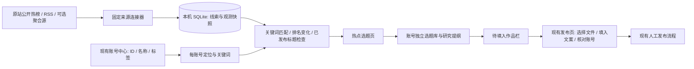

> 历史设计与实施记录（2026-10）；不构成本次发布的验收结论，未实现部分仍是方案。

# 热点选题与现有账号平台的集成

实施日期：2026-10-17。目标平台：应用源码目录。本版更新源码；已有安装包和正在运行的进程需要另行重建或重启，才能使用新功能。

## 1. 实施决策

现有平台是 Flask + 原生 JavaScript + Qt 桌面窗口，账号及发布流程已经具备。第一版直接在其中增加“热点选题”页签，避免维护第二套账号和发布入口。新增模块只依赖 Python 标准库与项目已有 Flask，无需 PostgreSQL、Redis 或 Docker。规则模式可直接使用，AI 模式需配置自己的服务或本机模型。

此前的独立服务设计保留作未来多人协作方案；其中 TrendRadar 主 fork、FastAPI、PostgreSQL 和独立前端不是本次安装要求。

## 2. 使用路径

1. 启动源码版平台，打开顶部“热点选题”。下拉列表直接读取账号中心的现有账号。
2. 点击“编辑账号定位”，填写方向、受众、赛道词、关键词、排除词和关注地区。可选择知识科普、人物故事、行业经营、自定义方向中的一种或多种表达方式。
3. 点击“刷新热点”。“适合这个账号”显示标题命中的线索，“探索全部热点”用于补充发现。
4. 至少获得两次内容不同的有效榜单快照，才有可能在“正在上升”看到排名上升的匹配线索。资讯流顺序不计算为热榜排名。
5. 选择表达方式，收藏并生成提纲；在选题详情中保存文案、研究笔记与制作状态。
6. 点击“用于发布”，进入原有发布页。先选作品文件，再点“填入当前作品”，将文案及所属账号填入。已有文案时会提示替换。之后照常核对和发布。
7. 需要持续监控时，在监控设置中打开自动刷新，选择 15 / 30 / 60 分钟。默认关闭，且仅在平台进程运行时执行。

## 3. 账号方向与赛道扩展

账号中心仍是账号身份的唯一来源，新增配置以 `account_id` 关联。标签在每次匹配时读取，账号改名不破坏关联。删除账号后，该账号的选题接口不再开放；历史快照留在本机，暂不提供重新绑定入口。

默认继承现有标签，可在定位中关闭。明确包含“科普”“故事”“餐饮”的标签用于设置初始表达方式；不会根据账号名称自动猜测人物设定。

| 创作方向 | 推荐填写的赛道/关键词示例 | 表达方式 |
| --- | --- | --- |
| 泛知识科普 | 科普、科学、心理、宇宙、历史；再按账号专长补充 | 知识科普 |
| 有感染力的真实故事 | 故事、人物、救援、重逢、传承、老店、志愿者 | 人物故事 |
| 餐饮垂直 | 餐饮、外卖、菜单、经营、成本、供应链，加所在城市 | 行业经营；也可搭配人物故事 |
| 新赛道 | 直接输入该行业关键词，不需要修改表结构 | 自定义方向或已有表达方式 |

内置词表对部分常用赛道做透明的关键词扩展。规则列表依赖关键词；可选 AI 模式将账号定位、受众等完整配置用于语义判断。未知赛道建议同时补充定位和关键词。当前单机账号隔离是产品分组，不是多人权限系统。

## 4. 采集与时间语义

| 来源 | 接入 | 本机验证 | 数据含义 |
| --- | --- | --- | --- |
| 百度热搜 | 原站公开榜单 | 取得 50 条 | 热搜位置；来源链接是对应搜索页 |
| B 站热搜 | 原站公开热词接口 | 取得 30 条 | 热词位置；来源链接是搜索页 |
| B 站热门视频 | 原站公开热门接口 | 取得 30 条 | 热门内容流，不将返回顺序解释成热度排名 |
| IT 之家 | 原站 RSS | 取得 60 条 | 科技资讯；保留来源给出的发布时间 |
| 抖音热榜 / 上升推荐 | 原站公开接口，内存匿名会话 | 两类列表均已实测读取 | 热榜位置、来源热度；上升推荐不当作本机增长率 |
| 微博 / 知乎 / 今日头条 / 澎湃 | 各自原站公开接口 | 均已实测读取 | 热榜线索；澎湃保留来源发布时间 |
| 少数派 / ScienceDaily | 原站 RSS | 均已实测读取 | 知识和科技选题资料；ScienceDaily 标题为英文 |

以上原有来源之外，现已接入40个频道、26个网站，完整列表见[来源目录](source-catalog.md)。新增腾讯、网易、凤凰、快手、红餐网、华尔街见闻、科学网、中新网分类、NASA等来源。界面可分组勾选或全选。

为避免升级时旧进程不认识新来源，新增来源先存入 `monitor-next-catalog`，仅目录版本匹配的新代码读取；旧程序保留兼容来源。用户在新版保存来源设置后清除升级暂存。刷新开关、间隔、AI配置和已保存选题保留。完全退出旧程序再启动后生效；重复双击仅激活旧窗口。未知来源的历史记录使用来源 ID 作为名称，避免列表因 KeyError 崩溃。

每个连接器固定目标 URL，12 秒超时，最大读取 2MB；最多4个主机并行，同一主机串行，SQLite由调用线程写入。抖音会先用最多6秒建立匿名临时会话，同轮热榜和上升推荐共用一份响应。账号标签、账号资料、发布账号登录 Cookie、选题笔记均不随采集请求发送。来源提供的标题和链接作为线索存储，不自动抓取全文或图片。

`first_seen` / `last_seen` 是本机观测时间。`published_at` 仅在来源提供有效时间时填写；聚合接口的响应时间不能替代新闻发生时间。界面区分“首次发现”和“来源发布”。

相同榜单内容不重复新增排名观测；不同快照记录来源内排名，最多比较最近两次不同快照。比较窗口为 24 小时。来源异常、超过 3 小时未观测、已离开最近榜单的线索，不进入正在上升列表。热度不跨平台相加；本版尚未做跨来源事件聚类。

## 5. 推荐与提纲

抖音账号在新鲜抖音线索上获得8分的透明排序加分。“抖音热点”查看已启用的抖音两类来源，不要求命中账号关键词。AI 候选从最多5000条线索中筛选，为新鲜抖音线索优先预留最多约三分之一，再按网站轮流补充并去除相同标题，避免同一网站多个频道占满候选；输出仍按账号定位判断是否适合，允许返回空结果。

排序采用可解释规则：标题命中词数及是否匹配为主，来源内排名与排名上升为辅；关注地区命中加分，同账号已有相同标题的提交或发布记录减分。分值范围 0—100，是当前规则的排序值，不是爆款概率或经过训练的质量评分。

“人物故事”提纲强调处境、目标、真实行动、可查转折和余波；“知识科普”强调现象、原理、例子和边界；“行业经营”强调背景、措施、成本和执行条件。它们是研究步骤模板，不是对新闻事实的自动总结。编辑区的作品文案初始为空，避免将研究要求误填成可发布成稿。

## 6. 存储

数据库位于现有数据目录的 `topic-radar.sqlite3`，遵守原项目的 `MEDIA_ASSISTANT_DATA_DIR` 设置；账号登录目录不变。

| 表 | 作用 | 约束 |
| --- | --- | --- |
| profiles | 每账号的定位配置 | account_id 主键；revision 防止旧页面覆盖新修改 |
| settings | 监控开关、间隔、来源 | 固定来源白名单 |
| source_state | 每来源成功时间、错误、指纹、条数 | 失败时保留上一次成功状态 |
| leads | 来源内线索身份、标题、链接、时间 | source + native_key 唯一；不以排名当作 ID |
| observations | 每次不同快照的排名 | source + batch + lead_id 唯一 |
| topics | 按账号保存的选题与文案 | account_id + lead_id + style 唯一；保存原线索快照 |

SQLite 使用 WAL，写入事务与 15 秒锁等待。线索/观测保留 30 天，推荐读取最近 7 天、最多 1500 条候选，返回前 100 条；每账号选题库目前最多显示最近更新的 300 个选题。选题快照不随线索过期删除。

备份时关闭应用后复制 `topic-radar.sqlite3` 及仍存在的同名 `-wal` / `-shm` 文件，或者使用 SQLite 在线备份 API；不要在写入过程中只复制主文件。源码回退不会删除新增数据库。

## 7. 接口与代码位置

所有新接口位于 `/api/topic-radar`，仅接受本机 Host；修改接口要求 JSON，校验同源 Origin，正文限 64KB。账号查询不返回登录状态文件或凭据。

| 接口 | 用途 |
| --- | --- |
| GET /accounts | 现有账号的最少展示字段及定位 |
| GET/PUT /accounts/{id}/profile | 读取/修改定位，更新时传 revision |
| GET /accounts/{id}/feed?lane=matched/rising/all | 获取匹配推荐 |
| GET /status、PUT /settings | 来源健康、刷新状态与监控设置 |
| POST /refresh | 启动后台刷新，返回 202；单进程不并发，完成后冷却 60 秒 |
| GET/POST /accounts/{id}/topics | 选题列表、按线索及表达方式幂等收藏 |
| PATCH /accounts/{id}/topics/{topic_id} | 更新状态/文案/笔记，传 revision |

`core/topic_radar.py` 负责存储、连接器、匹配与研究结构；`core/topic_routes.py` 负责接口。`templates/topic_radar.html` 和 `static/topic-radar.*` 提供界面。原文件仅增加 Blueprint、页签、样式脚本、待填入栏及 activeTab 允许值。打包配置附带第三方许可说明。

## 8. 开源复用结论

本次按 [NewsNow](https://github.com/ourongxing/newsnow) 与 [DailyHotApi](https://github.com/imsyy/DailyHotApi) 的公开源结构实现轻量连接器，随项目保留 MIT 说明 `TOPIC_RADAR_NOTICES.md`。没有复制 TrendRadar 的 GPL 代码，也不需要把现有桌面平台迁移为它的 fork。

[TrendRadar](https://github.com/sansan0/TrendRadar) 仍适合后续独立运行的采集/通知服务评估；需要服务器持续采集、复杂报告和更多来源时再决定是否引入。详细源码审查见 `open-source-core-review.md`，RSSHub 等备选见 `source-projects.md`。

## 9. 验收与后续边界

验证包括真实来源连通与解析、模拟数据的账号匹配/版本冲突/错误降级，以及真实 Chromium 中切换账号、编辑方向、收藏、保存文案和填入现有发布页。发布行为使用模拟任务或检查未调用发布接口，不接触真实平台的发布动作。

集成回归共 51 项全部通过，包含原有账号后台、设置持久化、数据保留、发布流程及发布界面。13 个源码/测试/文档文件已合并并核对 SHA256；原文件备份在 `integration/backups/20261017-112954`，完整回执在 `integration/deployment-receipt.json`。

本版尚不包含：全网覆盖、全文抓取、跨源事件聚类、24 小时服务器调度、消息通知、播放量反馈学习、多人权限、安装包重建。可配置 AI 服务已作为后续增量实现，见下节。

## 10. 自定义 AI 增量

实现位于 `core/topic_ai.py`，前端为 `static/topic-ai.js` 及两个 AI 模板。支持 Chat Completions 与 Responses、自定义地址/模型/Key/提示词、输出 Token、Temperature、超时、候选数与额外 JSON 参数。使用 Python urllib 发起请求，无新增 Python 依赖。Windows DPAPI 加密 Key，读取配置仅暴露是否已设置，变更目的地址后不会沿用旧服务的 Key。

新增 `/ai/config`（GET/PUT）、`/ai/test`（POST）、`/accounts/{id}/ai/recommendations`（GET 缓存 / POST 分析）和 `/accounts/{id}/topics/{topic_id}/ai`（POST 生成）。均沿用本机 Host、同源修改、账号身份与请求大小校验。

AI 配置保存于 settings 的 `ai-config`，推荐缓存按账号键保存；提纲和文案建议保存于选题 payload 的 `ai_suggestion`。模型只能返回提供过的候选 ID；生成内容校验结构后保存为建议，采用按钮才修改当前提纲或草稿。配置/账号/选题版本变化时拒绝过期结果。请求采用单进程互斥，不自动重试，不因自动采集、页面刷新或进入选题而调用 AI。

完整配置与发送数据范围见 [AI 配置说明](../../AI_CONFIG.md)。增量验收共 65 项通过，包含 Windows 加密、两种协议、跨账号隔离、异常响应、并发修改，以及真实 Chromium → Flask → 本机模拟模型服务的完整使用路径；尚未提供实际服务商凭据，未进行付费接口调用。

## 11. 由高播放作品推断定位

新增 `core/topic_profile.py`、`static/topic-profile.js` 和对话框模板。账号级接口为 `profile/works`（GET/PUT）、`profile/analysis`（GET/POST）、`profile/adopt`（POST）。作品导入沿用本机同源保护，正文限额为512KB，其余接口仍为64KB。

按播放量自动选取前3/5/10个作品；缺少字幕或内容摘要时要求补充，避免仅按标题猜测。AI 输出定位、受众假设、领域、关键词、表达方式、内容共性、样本限制与至少两个作品的引用依据。建议保存在独立分析记录中，确认采用后才更新账号定位；已有排除词与地区保留，标签继承由用户选择。

数据和建议按账号保存在 SQLite settings，分别为 `profile-works:{id}`、`profile-analysis:{id}`，带数据/定位版本校验。保留 CSV/JSON 导入和逐个补充 TXT/SRT/VTT 的方式；后续已接入下一节的自动后台读取，语音转写和视频画面分析仍未实现。详细说明见 [作品定位分析](../../PROFILE_ANALYSIS.md)。

## 12. 打开后台 / 账号检查时只初始化一次

在 `core/tasks.py` 的首次打开后台、已有窗口回到后台首页、账号检查确认登录后接入初始化。`core/creator_works.py` 只在现有登录浏览器上下文内读取对应平台创作者数据；不创建每日登录计划，也不在发布、打开主页/作品链接时抓取。

`core/profile_bootstrap.py` 将状态存入 `bootstrap:{账号ID}`。导入租约防止并发重复读取；成功导入和定位完成分开记录，成功导入后不会因 AI 未配置或失败而重新抓取。后台监控线程只续做已导入资料的分析。首次空白定位自动采用，已有编辑定位生成待审核建议；完成后停止自动分析。用户可选择重试未完成步骤或明确重新导入。

连接器适配抖音创作者作品列表、B站创作者稿件列表、小红书数据页自己的签名响应。按页面/时间预算读取并保存统计较高的200条有效视频，记录是否读完及数据口径；小红书阅读量与播放量区分展示。没有足够字段或平台改版时显示未完成，不伪造成功。

默认分析前5个，不足5个时取前3个。有字幕/内容时使用相应文本；仅有后台标题和发布文案时，允许初步主题定位，强制注明未观看视频、未转写以及无法判断画面和完整叙事。每次分析使用已配置的服务，同一配置失败最多3次并间隔5分钟，用户可重试或更换配置。已完成状态持久化，重启不会重做。

新增账号级 `profile/bootstrap` GET/POST 接口和初始化状态区。93项回归测试通过，包含并发导入、防重复、启用AI后的续做、人工定位保护、失败恢复、两入口触发、三平台响应解析，以及真实 Chromium 对模拟小红书签名页面的分页捕获。尚未在用户真实后台运行新采集，接口实际可用性由下次打开后台/检查账号时的状态确认。
