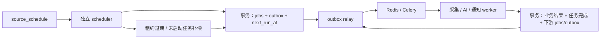

> 历史设计与实施记录（2026-10）；不构成本次发布的验收结论，未实现部分仍是方案。

# 运行架构、任务可靠性与交付验收

本文描述多赛道热点选题平台的目标运行架构，属于实施设计，尚未部署或压测。基础选型为 React + Vite 静态前端、FastAPI、PostgreSQL + pgvector、Celery + Redis，以及独立 scheduler。后端采用同一 Python 代码库、多进程运行。

适用的首期规模假设：1—10 名用户、最多约 20 个账号档案、5—8 个稳定数据源。实际容量以数据源验证和压测为准。本文不承诺全网覆盖、平台分钟级更新或某个未经验证的月费。

用户希望优先寻找可二次开发的开源项目。若最终复用外部开源采集服务，可将其单独容器化，通过 connector 接入本平台；它提供的聚合结果仍需要本平台记录来源、采集时间、数据质量和快照。这不会改变本平台的任务账本、账号隔离、预算和通知设计。原项目是否适合作为业务主体，需要另行核查许可证、代码结构和多用户能力，不能仅凭功能列表认定兼容。

## 1. 进程与部署边界

| 进程或组件 | 职责 | 初期实例数 |
| --- | --- | --- |
| gateway | HTTPS、静态前端、反向代理 `/api` | 1 |
| api | 登录、账号档案、检索、选题库、任务查询与创建 | 1 个容器，worker 数待压测 |
| scheduler | 根据数据库计划产生任务、转发 outbox、修复超时任务 | 1 |
| worker-ingest | 拉取来源、解析、存快照、去重、事件聚合、规则计算 | 1 组 |
| worker-ai | 文本向量、事件摘要、账号专属角度、提纲生成 | 1 组 |
| worker-notify | 通知发送、回执查询 | 1 组 |
| postgres | 业务数据、任务账本、预算账本、向量、outbox | 1 |
| redis | Celery broker；不能充当唯一任务记录 | 1 |
| connector-service | 可选；复用的开源采集服务或浏览器采集容器 | 按需 |

API 只做短请求。需要抓取、分析或通知的请求，先在数据库创建任务，返回 `202 + job_id`。前端通过任务查询接口轮询状态；后续确有必要再增加 SSE。浏览器关闭、API 重启都不应停止采集。

FastAPI 提供请求后的轻量后台任务，但需要独立进程执行的工作可以采用 Celery。本设计因任务持续运行和故障恢复要求，统一使用持久任务链路。[FastAPI 官方后台任务说明](https://fastapi.tiangolo.com/tutorial/background-tasks/)

部署使用 Linux + Docker Compose。Windows 开发环境使用 WSL2 或 Docker 中的 Linux 容器运行 worker；Celery 官方不支持 Windows 原生运行。[Celery 平台支持说明](https://docs.celeryq.dev/en/stable/faq.html#does-celery-support-windows)

Compose 支持单服务器部署；生产配置应固定应用镜像、设置重启策略、分离环境参数。[Docker Compose 生产部署说明](https://docs.docker.com/compose/how-tos/production/)

生产约束：

- 只开放 HTTPS 入口，PostgreSQL、Redis 和内部 connector 仅处于私有网络。
- api、scheduler 和三个 worker 使用同一构建版本，通过不同启动命令运行。
- 数据库迁移作为独立发布步骤执行，禁止每个 API worker 启动时同时迁移。
- 密钥通过服务器密钥管理或受限环境文件注入，前端构建产物、日志和 Git 均不包含密钥。
- 配置健康检查、资源上限、优雅退出时间和自动重启；升级先停止新增调度，再等待或回收在途任务。
- 初期单主机是可恢复部署，不是高可用部署；主机故障的恢复依赖备份和部署记录。

## 2. 只有一个权威调度机制

本平台使用独立 scheduler，**不部署 Celery beat**，不在 API startup 中启用定时器，也不额外以系统 cron 产生同类业务任务。



outbox relay 是 scheduler 内的独立循环，只负责转发已落库任务，不制定第二套排程。未来可以单独扩展 relay，仍然只保留一套数据库排程规则。

`source_schedule` 保存来源、采集范围、周期、`next_run_at`、启停状态和时区。采集范围区分同一平台的榜单、栏目、关键词或地区，避免误把整个来源视为一个任务。

每次排程在短数据库事务内完成：锁定到期计划，创建任务和 outbox，推进 `next_run_at`。数据库唯一键防止重启、手工重跑或误启动多个 scheduler 时重复创建同一采集时隙的任务。

计划追赶策略按任务类型确定：

- 热榜采集在长时间停机后只抓取当前状态，不能用当前数据伪装补齐过去的榜单。
- 支持历史游标的资讯来源可以从上次成功游标恢复，设置单轮追赶上限。
- 错过的即时通知进入摘要或过期，不能恢复后集中补发所有旧提醒。
- 日报根据用户时区的日期去重，所有数据库时间以 UTC 保存，展示和排程转换使用 IANA 时区。

初期 scheduler 建议每 10 秒检查一次到期任务；这是待压测参数。实际采集频率由来源更新节奏、配额和许可条件决定，不能用调度器频率代替平台更新频率。

## 3. 持久任务账本与 outbox

### 3.1 最小数据结构

| 表 | 必要字段和约束 |
| --- | --- |
| `jobs` | `id, kind, queue, scope_key, workspace_id, payload_ref, dedupe_key, status, available_at, attempts, max_attempts, dispatch_generation, lease_token, lease_expires_at, heartbeat_at, created_at, started_at, finished_at, last_error` |
| `outbox` | `id, job_id, dispatch_generation, status, available_at, locked_until, attempts, published_at, last_error`；唯一 `(job_id, dispatch_generation)` |
| `job_attempts` | `job_id, attempt_no, lease_token, worker_id, started_at, finished_at, outcome, error_code`；保留每次执行记录 |
| `source_schedule` | `source_id, scope_key, interval_seconds, next_run_at, enabled, timezone` |
| `source_fetch_runs` | 每次实际拉取的开始、结束、HTTP/解析结果、内容时间、条数、关联快照、错误类别 |

`workspace_id` 允许公共任务为空，但唯一约束不能直接依赖 PostgreSQL 默认的可空列唯一行为。建议将公开/私有范围转换成非空 `scope_key`（如 `public` 或 `workspace:<id>`），使用唯一 `(scope_key, kind, dedupe_key)`。

幂等键按业务含义生成：

- 采集：`source_id + feed_scope + scheduled_slot`。
- 文章抽取：`source_item_id + content_hash + extractor_version`。
- 事件基础分析：`event_id + evidence_version + analysis_version`。
- 账号角度生成：`account_id + profile_version + event_id + evidence_version + prompt_version`。
- 通知：使用第 6 节的投递唯一键，不以消息文本作为唯一键。

同一业务结果重试使用同一个 job；用户明确重新生成但改变配置或版本时，创建新的 job。手工重试必须记录操作者和理由。

### 3.2 状态转换

```text
pending → queued → running → succeeded
                       └─→ retry_wait → queued
                       └─→ failed
pending / retry_wait / queued → cancelled
```

`jobs` 是状态权威；Celery 的状态和返回值只用于诊断，不作为用户界面的最终依据。任务完成、结果写入、下游任务创建放在同一数据库事务中，避免结果成功但下一阶段永远未创建。

用户取消只禁止后续工作和结果写入，并尽力中断在途执行。外部请求已经提交时，取消不能撤销已经发生的模型费用或消息发送。

### 3.3 outbox 转发语义

1. relay 领取可投递记录并设置短租约，避免长时间持有数据库事务等待网络。
2. 向 Celery 投递 `job_id + dispatch_generation`，不在消息内携带整篇原文或密钥。
3. broker 接受后，更新 outbox 为已发布；仅在 jobs 仍处于可排队状态时更新为 queued，不能覆盖已经开始或完成的任务。
4. 若投递成功后、标记完成前进程崩溃，恢复后会再次投递同一消息，这是允许的重复。
5. 若 Redis 在投递后丢失消息，数据库中的 queued 超时补偿会重新发布。

整体按 **至少一次投递、幂等落库** 设计，不承诺端到端恰好执行一次。

## 4. 租约、fencing 与补偿

worker 从数据库原子领取可执行任务，核对消息的 `dispatch_generation` 与当前任务版本相符，递增 `attempts`，生成新的 `lease_token`，写入 `lease_expires_at`。过期投递版本，以及已成功、已取消、已失败或仍有有效租约的重复消息直接退出。终态任务不会仅因队列消息重放而重新执行。

运行中的任务按需发送心跳。业务结果提交时必须在同一事务中校验任务仍为 running、租约令牌仍匹配、任务未取消；校验失败则整笔事务回滚。这个令牌构成 fencing，阻止旧 worker 在租约被新 worker 接管后覆盖新结果。所有有副作用的落库路径都必须执行此检查，不能只在最后更新 jobs 时检查。

跨多个短任务的流水线优于一个持续数十分钟的大任务。网络连接、读取、整体请求和 Celery 任务分别设置超时，避免无心跳的永久占用。

建议起始参数，均需按具体任务压测调整：

| 参数 | 初始建议 | 调整依据 |
| --- | --- | --- |
| 心跳 | 20 秒 | 调度抖动、数据库负载 |
| 租约有效期 | 120 秒，并续租 | 必须明显大于心跳间隔；外部请求等待期间仍需续租 |
| 单次采集网络超时 | 连接 10 秒、整体 45 秒 | 来源响应时间与配额 |
| 单次 AI 请求超时 | 120 秒 | 所选模型实际延迟与输出长度 |
| 任务硬时限 | 采集 180 秒、AI 300 秒、通知 90 秒 | 浏览器或分段任务另外定义 |
| queued 启动期限 | 常规任务 10 分钟 | 根据队列拥堵和业务时效配置 |
| 最大业务尝试次数 | 5 次 | 对应来源、错误类别和人工处理需求 |
| 退避 | 指数退避加随机抖动，尊重 Retry-After | 避免同时恢复时冲击来源 |

Celery 使用完成后确认，并针对可安全重试任务配置 worker 丢失后的重投递。必须结合数据库尝试次数、租约与死任务处理；不能认为只打开 `acks_late` 就不会丢任务或重复执行。Celery 官方说明任务应设计成幂等，且进程异常情况下确认行为有额外边界。[Celery 任务说明](https://docs.celeryq.dev/en/stable/userguide/tasks.html)

Redis visibility timeout 要大于允许的最大任务运行时长，不能小于上表任务硬时限。未来几小时或几天执行的工作保留在数据库计划中，到期再投递；不大量使用长 ETA/countdown。Redis broker 的可见性超时可能造成重投递，官方也明确指出 broker 不是数据库。[Celery Redis broker 说明](https://docs.celeryq.dev/en/stable/getting-started/backends-and-brokers/redis.html)

scheduler 的补偿扫描：

- pending 或 retry_wait 到期但无可用 outbox：在事务中补建 outbox。
- queued 长时间未被领取：确认没有有效执行租约后，增加 `dispatch_generation` 并补投；设置频率限制，不因暂时积压制造无限重复消息。
- running 租约失效：记录该次失败，根据错误策略进入 retry_wait 或 failed，下一次执行使用新令牌。
- 连续失败达到上限：进入可查看、可人工处理的失败列表；保留输入引用和错误上下文。
- PostgreSQL 不可用：停止任务领取和外部有副作用调用。无法确认幂等状态时不猜测执行。

外部 HTTP 调用无法被数据库 fencing 撤销。租约只能阻止失效 worker 修改本地最终状态，外部重复调用和费用需要单独处理。

## 5. 采集、AI 与通知资源隔离

采集、AI、通知使用不同 Celery 队列和 worker 配额。初期可将规则处理放入采集组，新增独立计算队列要以实际积压为依据。

每一来源设置请求并发和频率上限；同一榜单默认不允许两次拉取同时运行。AI 同时设置全局、供应商、workspace 并发限制。通知独立运行，防止长篇故事分析阻塞提醒。

初始可从采集并发 2、AI 并发 2、通知并发 1 起步，并明确这是待压测配置。多 worker 扩容后，额度和限流状态必须跨进程协调，不能依赖各进程内存计数。

消息 broker 使用独立 Redis 实例或独立的持久部署，配置 AOF 和 `noeviction`；缓存淘汰不能删除消息键。Redis 持久化能够降低重启损失，但 PostgreSQL 账本与补偿机制仍是恢复依据。[Redis 持久化说明](https://redis.io/docs/latest/operate/oss_and_stack/management/persistence/)

如果来源需要浏览器，单独容器运行、限制内存和并发；采集返回超过预期大小的正文、跳转链或附件时设置上限。复用开源服务时，记录其版本、实际支持的来源、更新时间字段含义、许可条件和错误格式。

## 6. 通知幂等与外部投递边界

`notification_delivery` 使用唯一键：

```text
workspace_id + account_id + rule_id + event_id
  + trigger_revision + channel + destination_id
```

`trigger_revision` 表示首次命中、跨越新的升温等级或实质进展，不随每一次轻微排名变化增长。发送前检查冷却时间、每日上限、用户时区的免打扰安排和事件是否已过期。账号配置变化不应无条件重发旧热点。

投递状态至少包括 `pending / sending / accepted / delivered / failed / delivery_unknown`。渠道仅返回“请求接受”时记录 accepted，不虚构用户已经收到或阅读。

优先使用渠道提供的幂等键，键应由 delivery id 稳定生成。投递超时可能代表“平台已收下，但响应丢失”，处理顺序为：

1. 有外部请求 ID 和查询接口时先查回执。
2. 渠道支持幂等请求时，用同一幂等键重试。
3. 两者都不支持时标记 delivery_unknown；MVP 默认不盲目自动重发，在管理界面说明“可能已发送”，允许人工重发。

数据库唯一键可以防止重复创建提醒，不能保证外部平台恰好发送一次。第三种策略在减少重复提醒的同时可能漏掉一次投递，这个取舍必须在渠道适配器中明确。AI 请求超时也可能已计费，不应把无响应直接视为零费用。

通知 worker 在外部请求前先持久化 sending 和本次尝试标识。若进程崩溃，新的 worker 发现上次仍为 sending，应先按“不确定是否已发送”处理，不能套用普通采集任务的自动重试逻辑。已经归类为 delivery_unknown 的发送任务可结束为 succeeded，但结果明确为待核对；另建回执核对任务，避免通用任务重试器再次发送。这里的 succeeded 只表示发送尝试已被完整记录，前端投递状态仍以 notification_delivery 为准。

外部渠道发送仅在用户配置并启用该渠道及规则后执行。第一版只实现一个渠道，先验证真实送达、失败和重复处理。

## 7. 来源健康、延迟与数据保留

来源状态至少区分正常、延迟、限流、鉴权失效、解析异常、暂停。HTTP 200 不足以判定健康：还要检查有效条数、字段完整性、时间有效性和解析成功率。空榜可能合法，不能一律视为故障；与该来源的历史基线一起判断。

页面和监控分别记录：

- 来源发布时间：文章发布或来源明确给出的榜单更新时间。
- 首次发现时间：平台第一次看到该内容的时间。
- 最近成功拉取时间：请求与解析最近成功的时间。
- 最近内容变化时间：按有效内容指纹发现变化的时间。
- 本平台生成时间：摘要、推荐和趋势计算的时间。

重复拉取相同榜单时，`source_fetch_runs` 仍记录本次成功并关联已有快照；不重复保存完整排名和正文。指纹基于排序后的有效业务字段，排除请求时间等每次必变字段。若排名、热度值、标题或来源时间变化，按所需分析字段决定是否产生新快照。

历史读取要能表达“此时间段多次确认榜单未变”和“此时间段没有成功采到数据”的差别。来源故障期间不把缺失数据算成热度下降；数据不足时不生成可靠性不明的加速结论。

建议保留策略：有效榜单快照 30 天起步，采集与任务详细日志 30 天，失败记录和月度用量汇总可更久保留；账号档案、收藏、笔记、草稿、发布记录按业务长期保存。原文及缓存材料按来源许可、用途和存储预算设置独立周期。

新部署需要真实积累 30 天快照，或从明确支持历史查询的来源导入。当前榜单不能反推出过去 30 天曲线，界面必须显示历史覆盖范围。

## 8. 监控与告警

优先构建可定位问题的结构化日志、健康状态和管理员页，初期不要求部署完整分布式追踪平台。日志包含 `trace_id、job_id、attempt、source_id、workspace_id、event_id` 等关联字段，敏感凭证和私有全文不写日志。

| 监控对象 | 核心指标 | 初始处理策略 |
| --- | --- | --- |
| 数据源 | 成功率、有效条数、解析失败、最近成功时间、源内容新鲜度 | 连续异常或超出合理更新窗口时告警 |
| scheduler | 心跳、到期计划延迟、补偿次数 | 心跳中断或大批计划逾期时告警 |
| outbox / 队列 | 最老待投递年龄、最老排队年龄、积压、重投递 | 优先判断来源限流、AI限额还是worker容量 |
| worker | 执行延迟、租约过期、重试率、失败率 | 自动恢复可重试任务，其余进入失败列表 |
| AI | 调用次数、实际 token/费用、预算预留、错误、输出校验失败 | 达预算阈值停止低优先级生成 |
| 通知 | accepted/delivered/unknown/failed、重复拦截数 | 区分渠道故障与明确未送达 |
| 数据库 | 连接数、慢查询、锁等待、磁盘、备份时间 | 临近容量阈值前处理 |
| 产品质量 | 人工聚合纠错、相关性反馈、选题收藏和采用 | 按账号和来源观察，避免只优化点击 |

告警针对状态变化，恢复后发送恢复信息；相同持续故障合并，并设置冷却，避免每次调度都报警。采集源自身每两小时更新时，15 分钟未出现新内容不应触发延迟告警。

所有告警阈值属于初始配置，先连续观察一周再调整。没有采集到历史样本或有效趋势时，应向用户展示明确状态，而不是由 AI 补猜。

## 9. AI 预算与费用核算

规则、去重和权限筛选先执行，只有确实新增或实质变化的候选事件进入 AI。公共事件基础分析共享；账号专属角度按配置和请求生成。缓存键包含内容/证据版本、模型、提示词、结构化输出版本，以及必要的私有范围。

预算通过数据库账本协调，不使用各 worker 独立计数：

1. 调用前按最大输入和输出限制估算预留费用，原子检查平台与 workspace 剩余额度。
2. 创建 `ai_run + reservation` 后才调用，记录模型、版本、用途和供应商请求 ID。
3. 成功后按实际用量结算并释放差额；失败但已计费时仍结算。
4. 外部超时导致费用不明时保留待核对预留，不立刻归零；能查询供应商账单时进行对账。
5. 达到上限则延后分析，保留来源链接、规则排序和历史摘要；不影响基础采集。

限制单次上下文、最大输出长度、每天分析事件数和账号提纲数。批量提纲请求显示预计任务量与剩余额度，避免一次操作生成数百份重复内容。

月度费用按下式测算，不在缺少供应商报价和真实用量时给出固定金额：

```text
总费用 = 主机与数据库 + 数据存储与备份 + 数据源授权
       + AI 输入/输出 token + 向量调用 + 通知发送 + 流量

AI 费用 = Σ(输入 token × 对应输入单价
           + 输出 token × 对应输出单价
           + 供应商其他明确计费项)
```

试运行一周后按缓存命中、事件去重、采纳率和平均每事件用量估算月度成本。20 个账号共享 5 个来源，不应将采集请求或公共事件摘要简单乘以 20。

## 10. 容量估算与扩展触发点

以 5 个来源、每 15 分钟采集一次、每个榜单 50 条计算：

```text
每日采集轮次 = 5 × 24 × 4 = 480
每日原始排名观测上限 = 480 × 50 = 24,000
30 天原始排名观测上限 = 720,000
```

这是全部轮次成功且每轮写入 50 条的计算上界，不代表每天 24,000 篇新文章。有效快照去重可减少持久排名记录，但比例需要实测。若 8 个来源均同频率同榜单长度，上界为 38,400 条/日、1,152,000 条/30 天。

容量估算还需计入索引、原文、来源响应、向量、版本记录和备份。不能只按排名观测行数推导总磁盘量。向量只为去重后的有效文本生成，不为每个排名快照重复生成。

初始主机可以以 4 vCPU、8 GB RAM 为压测起点，不构成容量保证。浏览器采集、全文规模、向量维度和模型 SDK 的并发行为会显著改变需求；模型推理默认使用外部 API，不在这台机器加载大模型。

建议的扩展顺序：先调整慢查询、批次、缓存和 worker 并发，再分离 PostgreSQL 或扩 worker 主机，最后按实际检索瓶颈引入专用搜索组件。初期保留 PostgreSQL + pgvector，不预先部署 Elasticsearch、Kafka 或 Kubernetes。

以可观测瓶颈触发扩容：最老排队任务持续超过业务时效、数据库查询延迟超过验收目标、磁盘预计不足一个保留周期、来源请求配额成为瓶颈。仅增加用户数不一定意味着需要拆微服务。

## 11. 多用户隔离、备份与恢复

公共来源与公共事件可以共享。账号档案、私人来源、笔记、草稿、反馈和通知目标按 workspace 隔离。权限检查必须覆盖列表、详情、全文检索、向量检索、导出和后台任务；只在前端隐藏按钮不足以隔离。

worker 从可信数据库任务记录读取 workspace 和来源权限，不能信任队列消息传入任意 workspace。公共缓存不能混入私有文本；共享 AI 分析时必须确认输入完全属于公共数据。

PostgreSQL 每日备份到独立存储位置，初期目标 RPO 不超过 24 小时；RTO 可暂定 4 小时，但只有实际恢复演练达到后才能宣称达标。数据库转储需要配套备份角色/权限等全局配置、pgvector 扩展版本、迁移版本和必要对象存储，不能只保存一个 SQL 文件就认为环境完整。[PostgreSQL SQL 转储说明](https://www.postgresql.org/docs/current/backup-dump.html)

若需要更低 RPO，使用托管时间点恢复或基础备份加连续 WAL 归档。WAL 归档不包含所有配置文件，部署配置与密钥恢复仍需另行准备。[PostgreSQL PITR 说明](https://www.postgresql.org/docs/current/continuous-archiving.html)

备份要求：

- 备份存储与业务磁盘分离，访问权限受限，必要时加密；同一主机另一个目录不算独立灾备。
- 自动检查备份结果、大小异常和最近成功时间；首发前完整恢复一次，以后定期演练。
- 凭据恢复方式单独保管，避免数据库备份泄漏全部外部渠道权限。
- 开发、测试与生产分别使用数据库、密钥和通知目标；测试运行不得向真实用户发送消息。

恢复步骤：停止对外发送，恢复数据库与所需对象，核对版本和行数，验证租户隔离，清理或隔离旧 Redis 队列，再由任务账本重建未完成工作。过期 lease 交给补偿器处理。

恢复到旧备份会丢失备份之后的通知发送记录；外部平台可能已经发送。这段窗口必须隔离并对账。无法确认的历史通知标记 unknown 或过期，不自动补发；确认新事件链路正常后再启用新通知。不能因“数据库里未发送”就认定外部世界也未发送。

## 12. 故障验收与质量门槛

以下是需要实施的验收用例，不代表当前已经通过。

| 场景 | 预期结果 |
| --- | --- |
| 同一抓取批次重复提交 3 次 | 原文/有效快照/事件关联不重复；尝试记录可追踪 |
| scheduler 在事务提交前/后崩溃 | 不产生半条计划；已落库任务最终可以执行 |
| 消息已发布但 outbox 未标记时崩溃 | 可以重复收到消息；最终业务结果唯一 |
| Redis 重启或丢失待消费消息 | 数据库 queued 补偿恢复任务；前端不误报完成 |
| worker 在业务落库前崩溃 | 租约到期后恢复；不存在部分成功结果 |
| worker 在结果提交后、ACK 前崩溃 | 重投递识别任务成功，不重复生成下游任务 |
| 旧 worker 失去租约后迟到提交 | fencing 拒绝其业务写入，保护新结果 |
| 数据库断连 | 不在无法确认租约和幂等状态时继续外部有副作用调用 |
| 来源返回 429、空榜或结构变化 | 分别限流、合法空值判断、解析异常处理，不统一当零热度 |
| 排名榜未变化但多次成功拉取 | 复用快照，记录新拉取时间；与采集缺失区别展示 |
| 两个账号同时生成同一公共事件分析 | 公共分析只创建一个有效任务；各自角度保持隔离 |
| 多个 AI worker 同时接近预算上限 | 原子预留阻止并发穿透，超额任务明确延后 |
| 通知发送成功但响应超时 | 使用渠道幂等/回执，或进入 unknown，不无条件重发 |
| A 用户猜测 B 的资源 ID、搜索或导出 | 所有读写和后台操作均被拒绝，无数据泄漏 |
| 从独立备份恢复空环境 | 业务数据、配置依赖可恢复；记录真实 RPO/RTO |
| 历史不足、来源中断、旧闻翻红 | 明确显示数据范围和时间，不伪造连续趋势 |

质量验收使用人工标注样本覆盖科普、人物故事、餐饮、相似人物不同事件、跨来源转载和旧闻重现。分别统计聚合准确率、错误合并、漏合并、账号相关性和证据链接完整度；不能以“页面能显示”和“模型能输出”代替质量验收。

建议先准备 200—300 条材料样本，并连续试运行至少 7 天。初步性能目标可设为：日常列表请求 p95 小于 1 秒；在 worker 无积压且来源正常时，采集任务启动延迟 p95 小于 2 分钟。目标需在约定硬件、数据量和并发条件下实测，来源自身延迟与外部模型响应单独报告。

## 13. 交付分期

| 阶段 | 必交范围 | 进入下一阶段的条件 |
| --- | --- | --- |
| 数据与开源验证 | 候选项目许可证/结构核查；至少 3 个源可持续接入，逐步达到 5 个；来源健康、快照、人物或行业深度材料 | 连续运行 7 天，延迟和缺失可解释；原始链接可追踪 |
| 业务 MVP | 账号与自定义赛道、事件聚合、趋势、基础分析、选题库、提纲；任务账本与租约同步实现 | 新增赛道不改业务代码；重放幂等；人工样本验证相关性与证据 |
| 小范围试用 | 1—10 用户、约 20 账号；一个通知渠道、预算、反馈、备份恢复、多用户权限 | 故障验收关键项通过，资源用量和月成本有真实测量依据 |
| 按需求扩展 | 5—8 个以上来源、新通知渠道、独立数据库/worker、推荐迭代 | 由覆盖缺口、持续积压、采纳反馈和实际预算决定 |

首期不自动发布内容、不训练推荐大模型、不建设多集群。用户需要的新增赛道应通过账号配置和模板完成；新增底层数据渠道仍需单独接入与验证。
